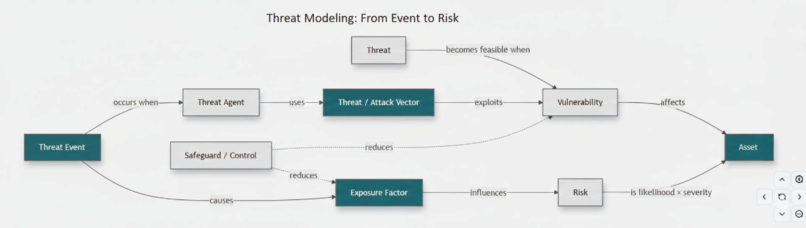
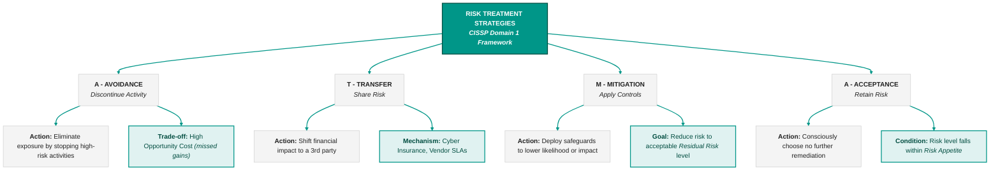
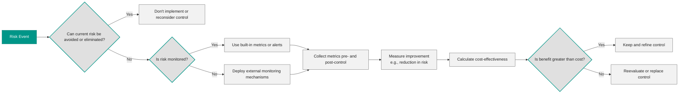
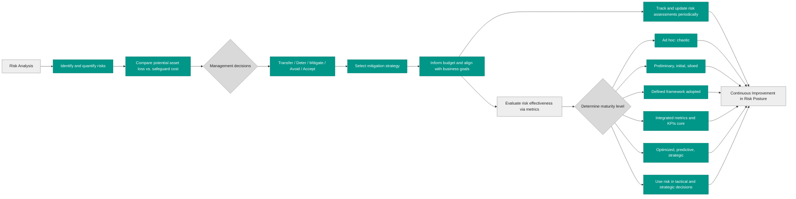

## 1.9.1 Threat and vulnerability identification ##

A **risk-based approach** in cybersecurity is essential because it `turns abstract fears into clear, manageable tasks`: first you assess what could go wrong (like which valuable assets are vulnerable, how likely bad things might happen, and what their impact would be), and then you respond in a smart way—by mitigating, transferring, accepting, or avoiding the risk based on your priorities and resources.

*Think of risk-based approach like locking your house (assets) after figuring out which doors or windows (vulnerabilities) a burglar (threat agent) might use (attack vector), instead of leaving everything locked just because "that's how you do it." You measure how exposed you are, put in alarms or cameras (controls), and stay alert to new tricks criminals invent—this keeps you efficient, proactive, and aligned with business goals.*

It all revolves around these human concepts:
- **Asset**: `The things you care about and need to protect`—like data, systems, or brand reputation 
- **Vulnerability**: A `weakness`—such as outdated software or poor passwords—that could let someone in 
- **Threat (and threat agent)**: The `potential danger`—a hacker, natural event, or even an insider—and the actor behind it
- **Attack vector**: The `route used`—like phishing emails or open network ports—`to launch the attack` 
- **Risk**: The `chance that a threat will exploit a vulnerability` and harm your assets—and how bad that harm would be 
- **Control (or safeguard)**: `What you do to reduce vulnerabilities or block threats`—technical tools, policies, training 
- **Exposure**: `How much of your asset is actually open to threats`, given its vulnerabilities.
- **Attack event**: `When someone actually hits you`—this is when theory becomes real harm.

By weaving together these concepts, a risk-based strategy becomes a living process.

> 🔗Some other important concepts like risk appetite, risk tolerance and risk capacity are concepts not so easy to grasp, this infographic will help you: https://it.pinterest.com/pin/397794579603964748/

Threat and vulnerability identification begins by understanding how a threat event can lead to risk. A threat agent uses an attack vector to exploit a vulnerability affecting an asset. Safeguards and controls can reduce vulnerabilities or limit exposure, making successful attacks less likely or less damaging. Ultimately, risk depends on the likelihood of an event and its potential impact. The CISSP mindset is to look beyond the threat itself and understand how threats, vulnerabilities, controls, exposure, and asset value interact.

> 🔗 [NIST SP 800-30r1](https://csrc.nist.gov/pubs/sp/800/30/r1/final) provides a list of threat categories, concepts and examples 

### Open Questions ###

1. What is the key difference between a threat and a vulnerability?

  
Show answer

A threat is a potential event that could cause harm, while a vulnerability is a weakness that makes an asset susceptible to that harm.

2. How do threats and vulnerabilities interact to create risk?

  
Show answer

Threats exploit existing vulnerabilities. When a threat successfully utilizes a vulnerability, it leads to risk, which is the likelihood of harm occurring.

3. Explain the concept of a safeguard and its role in risk management.

  
Show answer

A safeguard is a protective measure that mitigates risk by reducing vulnerabilities or neutralizing threats. Examples include firewalls, security cameras, and data encryption.

4. Differentiate between a threat agent and a threat event.

  
Show answer

A threat agent is an entity that intentionally exploits vulnerabilities, like a hacker or malicious software. A threat event encompasses both intentional actions by threat agents and accidental occurrences that could lead to harm.

5. Define a threat vector and provide an example.

  
Show answer

A threat vector is the path or method used by a threat agent to gain access to a target. For instance, a phishing email could be a threat vector used to steal credentials.

6. What is exposure in the context of risk assessment, and how is it quantified?

  
Show answer

Exposure refers to the potential for asset loss due to a threat. It represents the susceptibility to harm. The Exposure Factor (EF) is a quantitative value used in risk analysis to express this susceptibility.

7. Describe the relationship between risk and the potential severity of harm.

  
Show answer

Risk is directly proportional to the potential severity of harm. A threat that can cause significant damage poses a higher risk than one with limited potential impact.

8. Why is understanding the distinction between threats, vulnerabilities, and risk important for security professionals?

  
Show answer

Understanding these distinctions allows security professionals to accurately assess and prioritize risks, develop effective mitigation strategies, and allocate resources appropriately.

9. Can a threat exist without a corresponding vulnerability? Explain.

  
Show answer

A threat can exist theoretically without a corresponding vulnerability. However, it cannot materialize or cause harm without a weakness to exploit.

10. Provide a real-world example illustrating a threat, a vulnerability, and the resulting risk.

  
Show answer

Threat: A cybercriminal attempting to steal customer data. Vulnerability: A website with weak password security. Risk: The likelihood of the cybercriminal successfully exploiting the weak passwords to steal sensitive data.

---

## 1.9.2 Risk analysis, assessment, and scope ##

Risk in the context of security is the potential for harm resulting from `a threat exploiting a vulnerability` within a system. This concept is often quantified as the product of the probability of harm and the severity of that harm. Addressing either the threat or vulnerability directly through mitigation efforts reduces risk. Threats exploit vulnerabilities, leading to exposure, which is the essence of risk, and safeguarding assets against threats is key to risk mitigation. 

> ⚠ While it's impossible to eliminate all risks entirely, organizations can manage them by identifying acceptable and unacceptable risks, typically through a combination of quantitative and qualitative risk analysis methodologies. 

**Qualitative risk analysis** evaluates risk using descriptive ratings such as _low, medium,_ and _high_. It considers factors such as the likelihood of a threat event, the potential business impact, existing controls, and the criticality of the affected asset. A risk matrix can combine likelihood and impact to prioritize risks without requiring precise monetary values. This approach is useful when financial data is limited or when risks must be compared quickly. However, ratings can be subjective and should use consistent criteria.

**Quantitative analysis** assigns tangible dollar values to asset losses, while qualitative analysis assesses subjective factors. Most organizations utilize a blend of both methodologies to prioritize risks based on asset-threat pairings and rank them in order of criticality, aiming to minimize the overall risk exposure. In the process of risk ranking, quantitative analysis involves determining the anticipated annual cost of risk to the organization, known as the Annualized Loss Expectancy (ALE). This can be computed using the formula:

**ALE = SLE x ARO**

**ALE =  (AV x EF) x ARO**

Here, the acronyms correspond to:
- `AV`: Asset Value: The estimated financial worth or value of an asset within an organization.
- `EF`: Exposure Factor: The percentage of asset value likely to be lost in the event of a security breach.
- `SLE`: Single Loss Expectancy: The anticipated monetary loss from a single occurrence of a security incident.
- `ARO`: Annualized Rate of Occurrence: The estimated frequency or likelihood of a security incident occurring within a year.
- `ALE`: Annualized Loss Expectancy: The projected annual financial impact resulting from potential security incidents, calculated by multiplying the SLE by the ARO.

### Open Questions ###

1. Briefly describe the two main approaches to risk analysis: quantitative and qualitative.

  
Show answer

Quantitative risk analysis uses numerical data to determine the financial impact and probability of losses. Qualitative analysis considers subjective factors and the impact on intangible assets like reputation.

2. What does the acronym SLE stand for, and how is it calculated?

  
Show answer

SLE stands for Single Loss Expectancy and represents the estimated monetary loss from a single security incident. It is calculated by multiplying the Asset Value (AV) by the Exposure Factor (EF): SLE = AV x EF.

3. What is the significance of the Annualized Rate of Occurrence (ARO) in risk assessment?

  
Show answer

The Annualized Rate of Occurrence (ARO) is a crucial element in risk assessment because it estimates how frequently a particular security incident is expected to occur within a year.

4. How does the Annualized Loss Expectancy (ALE) help organizations prioritize risk mitigation efforts?

  
Show answer

ALE (Annualized Loss Expectancy) helps organizations prioritize risk mitigation efforts by providing an estimated annual financial impact of potential security incidents. Higher ALE values indicate more critical risks requiring immediate attention.

5. Provide the complete formula for calculating the ALE, explaining each component.

  
Show answer

The formula for calculating ALE is: ALE = SLE x ARO, where SLE is the Single Loss Expectancy and ARO is the Annualized Rate of Occurrence

---

## 1.9.3 Risk response and treatment (e.g., cybersecurity insurance) ##

Following the risk analysis process, security should implement the most cost-effective treatments, with the appropriate approach determined by the value of the asset and the type of risk identified in prior steps.

While risk cannot be eliminated entirely, it can be managed through four primary risk response strategies. The appropriate choice depends on the risk's potential impact, the organization's risk appetite, the cost of available controls, and the business objectives involved.

- **Avoidance**: `Eliminating the exposure by discontinuing the activity that creates the risk`. For example, an organization may decide not to deploy an application that cannot meet its security requirements. Although avoidance removes the exposure associated with that activity, it may also mean losing business opportunities or competitive advantages (opportunity cost).

- **Transfer**: `Shifting some of the financial consequences of a risk to another party`, typically through insurance or contractual agreements. For example, cyber insurance may cover certain costs resulting from a security incident. However, transferring financial consequences does not necessarily transfer accountability or eliminate the underlying risk.

- **Mitigation**: `Implementing security controls to reduce the likelihood of a risk occurring, its potential impact, or both`. For example, multi-factor authentication can reduce the likelihood of account compromise. The objective is to reduce residual risk to a level the organization considers acceptable, rather than necessarily eliminating the risk entirely.

- **Acceptance**: Formally `deciding to retain a risk without implementing additional measures to address it`. This may be appropriate when the risk falls within the organization's risk appetite or when further treatment would cost more than the expected benefit. Acceptance should be an informed decision made by an appropriately authorized risk owner, with the rationale and any required approval documented.

> ⚠ Remember the 4 terms above: avoidance, transfer, mitigation, acceptance but be aware that during your exam and your career you’ll find many synonyms.

### Open Questions ###

1. What is the primary factor in determining the appropriate risk treatment approach?

  
Show answer

The value of the asset and the type of risk identified are the primary factors in determining the appropriate approach to risk treatment.

2. Explain the concept of "opportunity cost" in the context of risk avoidance.

  
Show answer

Opportunity cost, in the context of risk avoidance, refers to the potential benefits or profits that a company might forgo by choosing to avoid activities that carry a certain risk.

3. How does risk transfer typically function in a business setting?

  
Show answer

Risk transfer typically involves a contractual agreement with another entity, often an insurance company, where the risk of potential loss is shared in exchange for a premium payment.

4. Provide an example of risk mitigation in practice.

  
Show answer

Installing a firewall to protect sensitive data is an example of risk mitigation. Other examples include implementing access controls, data encryption, and employee training programs.

5. In what circumstances might risk acceptance be a valid strategy?

  
Show answer

Risk acceptance may be a valid strategy when the cost of mitigating or transferring the risk is disproportionately high compared to the potential impact of the risk itself, or when the risk is considered low and unlikely to occur.

6. What is the relationship between asset value and risk treatment decisions?

  
Show answer

Higher-value assets generally warrant more robust and costly risk treatment measures, while lower-value assets might justify less stringent approaches. The level of risk associated with an asset also influences the choice of treatment.

7. Can risk be entirely eliminated? Explain your answer.

  
Show answer

It is generally impossible to completely eliminate risk. Every business activity inherently carries some degree of risk, and unforeseen circumstances can always arise.

8. Why is it crucial to analyze risk before implementing treatments?

  
Show answer

Analyzing risk before implementing treatments is crucial to understand the nature and severity of the threats, assess the potential impact on assets, and make informed decisions about the most effective and cost-efficient ways to manage those risks.

9. Describe the potential drawbacks of relying solely on risk transfer as a treatment strategy.

  
Show answer

Relying solely on risk transfer, such as insurance, can be costly in terms of premium payments. Additionally, it might not cover all potential losses or indirect costs associated with a risk event, and it doesn't address the underlying causes of the risk.

10. How can an organization determine what constitutes an "acceptable level" of risk?

  
Show answer

An organization determines an "acceptable level" of risk through a combination of factors, including its risk appetite, industry standards, regulatory requirements, and the cost-benefit analysis of various risk treatment options.

---

## 1.9.4 Applicable types of controls (e.g., preventive, detection, corrective) ##

Security controls are designed to `reduce the likelihood that a vulnerability will be exploited by a threat`. By implementing security controls, organizations can mitigate the risk of vulnerabilities being exploited and protect their assets from harm.
The aim of security control, as stated by NIST, is to preserve Confidentiality , Integrity and Availability of information. The term control is interchangeable with the following terms: countermeasure, safeguard, security mechanism, protection mechanism. In the table below we can see a common classification of Security Controls. There are infinite possible classifications, what we’ll see is just the most common classification in the infosec field:

Usually, security controls are classified in 2 different ways: security control types and security control functions, and this classification should be enough for your infosec certification or interview.

Control types, reported in the y axis of the table, usually answer the question “how are we protecting our assets” and are divided in:

- **Physical Controls** are `tangible measure used to protect (or detect) unauthorized access to physical systems or areas`.
- **Technical Controls** include the `measures implemented through technology`, such as software, hardware, or network systems to protect assets.
- **Administrative Controls** are `measures (usually documents) implemented through policies, procedures`, and other organizational measures defining personnel or business practices in line with the organization security goals.

The second way of classifying security controls is by Control functions, depicted in the x axis of the table, which are preventative, detective, and corrective. Despite their name, they usually are related at the time in which an incident happened, more specifically security control functions help us in classifying countermeasures happening before, during and after an incident or an unauthorized activity. Let’s shortly describe them.

- **Preventative controls** comprehend any security measure designed to stop any unwanted activity from occurring.
- **Detective Controls** are the solutions to detect and alert to unwanted or unauthorized activity in progress after occurrence.
- **Corrective Controls** are the measures to repair damage or restore resources to their prior state following an unauthorized activity.

As we previously said there isn’t a standard classification nor taxonomy for security controls, for example to make things a bit more complicated (but do not worry they are not too complicated) (ISC)2 classifies controls in 7 types based on the timing of unauthorized behaviors by motive, opportunity and means (MOM). You find them in this table:

| Control Type     | When Applied         | Purpose                                         | Examples                              |
|------------------|----------------------|--------------------------------------------------|----------------------------------------|
| Directive        | Before                | Guide behavior via policies and awareness       | Security policies, signage, posters    |
| Deterrent        | Before                | Discourage violations with perceived consequences | Guards, mantraps, warning banners      |
| Preventive       | Before                | Stop threats before they occur                  | Firewalls, IPS, antivirus              |
| Detective        | During / After        | Detect and report active or past events         | IDS, SIEM reviews, honeypots           |
| Corrective       | During / After        | Halt impact and restore operations              | Quarantine infected systems, terminate processes |
| Recovery         | After                 | Restore to normal operation                      | Backups, system shadowing, DR plans    |
| Compensating     | Before / During / After | Provide alternate protection when standard controls are missing or insufficient | PINs replacing weak passwords, layered controls |

> ⚠ Trying to memorize any Security Control categorization, or also memorizing where a security Control is located in the table below is an exercise not useful at all.

>  ✓ There are some concepts that we should always take in mind when dealing with Security Controls, they are:
>- `The same control may fill within different classifications`: Never overthink about the right classification of a control when studying for your certification or when talking to an InfoSec practitioner.
>- All control types are `preventive by nature`.
>- `Preventive and Detective controls are complementary` (always, when possible, first prevent and then detect).
>- Implementing Security Controls must always be `cost effective`, it means that based on the value of the asset you are protecting the costs of implementing a security control must be less than its benefit.
>- Usually Controls are `used in layers`, combining multiple security controls to develop defense in depth (so that if a layer fails the next one will help in preventing a breach). To better understand this concept, you can imagine a rainbow, to reach the pot of gold you must pass through many different layers.

A **Security Control Framework** is a `collection of security controls and implementation and audit guidelines usually organized as a template to help organizations in mitigating their risks.` Usually, Organizations select and customize security control frameworks based on their organizational needings. The selection process is also known as scoping while the customization process may be also called tailoring. Alternatively, Organizations could also build up a proprietary Security Control Framework. In the following we briefly describe 5 common Security Control Frameworks.

**NIST Cybersecurity Framework (CSF):** Developed by the National Institute of Standards and Technology (NIST), the CSF provides a risk-based approach to managing cybersecurity risk. For CISSP candidates, its primary purpose is to help organizations align cybersecurity activities with business objectives, prioritize risks according to their potential impact, and select appropriate safeguards based on risk appetite, regulatory obligations, and available resources.

NIST CSF 2.0 organizes cybersecurity outcomes into six core functions: **Govern, Identify, Protect, Detect, Respond, and Recover**. These functions help organizations establish accountability and risk strategy, understand their assets and exposures, implement safeguards, detect security events, manage incidents, and restore affected services.

The CSF is a **framework for managing cybersecurity risk, not a prescriptive checklist of controls**. It supports risk-based decision-making and can be used alongside standards such as NIST SP 800-53 and ISO/IEC 27001 to select, implement, and evaluate security controls appropriate to the organization's needs.

**NIST SP 800–53**: more detailed and prescriptive than NIST CSF, provides a comprehensive set of security and privacy controls for federal information systems and organizations. The controls were meant for agencies in order to comply with the Federal Information Processing Standards (FIPS) but many other organizations have voluntarily accepted it to assist them improve the security of their systems. It is organized into 20 control families, each of which addresses a specific area of concern, listed below:

| Code   | Control Family (NIST SP 800-53)           |
| :----- | :---------------------------------------- |
| **AC** | Access Control                            |
| **AT** | Awareness and Training                    |
| **AU** | Audit and Accountability                  |
| **CA** | Assessment, Authorization, and Monitoring |
| **CM** | Configuration Management                  |
| **CP** | Contingency Planning                      |
| **IA** | Identification and Authentication         |
| **IR** | Incident Response                         |
| **MA** | Maintenance                               |
| **PE** | Physical and Environmental Protection     |
| **PL** | Planning                                  |
| **PM** | Program Management                        |
| **PS** | Personnel Security                        |
| **PT** | PII Processing and Transparency           |
| **RA** | Risk Assessment                           |
| **SA** | System and Services Acquisition           |
| **SC** | System and Communications Protection      |
| **SI** | System and Information Integrity          |
|        |                                           |

Every family contains many controls (in total there are more than 1000 controls), this allows practitioners to use SP 800–53 also as a comprehensive checklist. 

In order to apply these controls NIST SP 800–53 prescribes a **four-step process**:
  1. Select the appropriate security control baselines.
  2. Tailor the baselines.
  3. Document the security control selection process.
  4. Apply the controls.

🔗 **NIST guidance:** NIST SP 800-53 Rev. 5 is available for free here: [NIST SP 800-53](https://csrc.nist.gov/pubs/sp/800/53/r5/upd1/final) 

**ISO/IEC 27001** is an international standard that provides a framework for establishing, implementing, maintaining, and continually improving an organization’s information security management system (ISMS). It includes a set of controls and guidelines for protecting sensitive information and assets, and can help organizations meet applicable regulatory requirements and industry standards. The 2022 edition includes 93 controls organized into four categories, listed in Annex A:

- Organizational Controls: Address information security policies, risk management, asset management, supplier relationships, incident management, and other organization-wide security requirements.
- People Controls: Focus on personnel-related security, including screening, security awareness and training, responsibilities, and measures to address security risks associated with employees and other individuals.
- Physical Controls: Protect facilities, equipment, and information from physical and environmental threats through measures such as secure areas, access restrictions, equipment protection, and secure disposal.
- Technological Controls: Address technical safeguards such as access control, authentication, cryptography, logging, monitoring, vulnerability management, and network security.

**COBIT** was developed by the Information Systems Audit and Control Association (ISACA), provides a set of best practices for managing and governing information and technology (IT) assets. COBIT is not purely security focused: it deals with all aspects of information technology, security being only one component. COBIT is a set of practices that can be followed to carry out IT governance, which requires proper security practices. It includes a set of control objectives and related control practices that can be used to help organizations align their IT activities with their business objectives and mitigate risks.

**The Center for Internet Security (CIS)** is a nonprofit organization that, among other things, maintains a list of 18 security controls (comparable to the NIST 800–53 families )to mitigate the threat of the majority of common cyberattacks. The controls are divided in 3 families, which are:
- Basic: These key controls should be implemented by every organization to achieve minimum essential security.
- Foundational: These controls embody technical best practices to improve an organization’s security.
- Organizational: These controls focus on people and processes to maintain and improve cybersecurity.

Under these 18 controls (in version 8.1) , CIS provides many subcontrols.

Every of the 5 frameworks above mentioned has its own certifications, SMEs (subject matter experts) and consultants. What was reported above was just a quick excursus.

🔗 Do Security Controls sometimes make you feel stupid ?: https://medium.com/@lorenzoleonelli/do-security-controls-sometimes-make-you-feel-stupid-507a9987d709

### Open Questions ###

1. Explain the three core security principles that security controls aim to preserve.

  
Show answer

Security controls aim to preserve confidentiality, ensuring information is accessed only by authorized individuals; integrity, ensuring information is accurate and protected from unauthorized alteration; and availability, ensuring authorized users can access information when needed

2. Differentiate between technical controls and administrative controls. Provide an example of each.

  
Show answer

Technical controls are implemented through technology, such as firewalls or intrusion detection systems. Administrative controls involve policies and procedures, like security awareness training or password policies.

3. Why is it crucial to implement security controls in layers, following the principle of defense in depth?

  
Show answer

Layered security, or defense in depth, provides redundancy and resilience. If one control fails, others can still mitigate the threat, reducing the risk of a successful breach.

4. What is the primary purpose of a Security Control Framework, and how does it assist organizations?

  
Show answer

A Security Control Framework provides a structured set of guidelines and best practices to help organizations implement and manage security controls effectively, mitigating risks and protecting assets.

5. Compare and contrast the NIST Cybersecurity Framework (CSF) and NIST SP 800-53.

  
Show answer

NIST CSF is a high-level, flexible framework that helps organizations manage cybersecurity risk. NIST SP 800-53 is a more detailed and prescriptive set of security controls specifically for federal information systems, but widely adopted by other organizations.

6. What are the four control categories in the ISO/IEC 27001 standard? Briefly describe each.

  
Show answer

ISO/IEC 27001's four control categories are: Organizational controls, establishing management framework for security; People controls, addressing personnel security awareness and training; Physical controls, protecting physical assets like facilities and equipment; and Technological controls, utilizing software and hardware for security.

7. How does COBIT relate to security practices within an organization?

  
Show answer

COBIT is a broader IT governance framework that includes security practices as a key component. By following COBIT, organizations can ensure their IT activities align with business objectives while maintaining proper security measures.

8. Explain the three families of security controls defined by the Center for Internet Security (CIS).

  
Show answer

CIS defines Basic controls, essential for minimal security; Foundational controls, technical best practices for enhanced security; and Organizational controls, focusing on people and processes to maintain and improve security.

9. Why is it important to consider cost-effectiveness when implementing security controls?

  
Show answer

Security control implementation must be cost-effective to ensure the cost of controls does not exceed the value of the assets being protected. This requires balancing security needs with budgetary constraints.

10. Why should you avoid memorizing specific security control categorizations or table locations?

  
Show answer

Memorizing specific categorizations is less important than understanding the core concepts and principles behind security controls. The focus should be on applying those principles to real-world scenarios and adapting to the specific needs of an organization.

---

## 1.9.5 Control assessments (e.g., security and privacy) ##

A **security and privacy control assessment** is a `formal evaluation of whether an organization's security and privacy controls are appropriately designed, implemented correctly, operating as intended, and achieving their desired outcomes`. The purpose is not simply to verify that controls exist, but to determine how effectively they manage risks and protect organizational assets and individuals.

Control assessments may be performed by internal teams or independent assessors and can be conducted at the organizational, system, or individual-control level. Assessors gather and evaluate evidence through methods such as:

- **Examine:** Review documentation, policies, configurations, logs, and other evidence.
- **Interview:** Question personnel to understand responsibilities, procedures, and actual practices.
- **Test:** Exercise controls to verify that they function as intended.
    
These methods help identify control deficiencies, gaps between documented procedures and actual practices, and opportunities to improve security and privacy. Vulnerability assessments and penetration tests may provide useful evidence, but they do not replace a broader assessment of control design, implementation, and effectiveness.

Assessment findings should be documented, evaluated according to their risk significance, and communicated to appropriate stakeholders. The organization can then prioritize corrective actions, assign responsibility, establish remediation deadlines, or formally accept residual risk through an authorized risk owner. Follow-up assessments and continuous monitoring help determine whether corrective actions are effective and whether controls continue to meet security and privacy requirements.

Privacy assessments are also important because security measures can themselves create privacy risks. For example, excessive employee monitoring or unnecessary collection and retention of personal information may introduce privacy concerns even when intended to improve security.

🔗 **NIST guidance:** NIST SP 800-53 Rev. 5 provides a catalog of security and privacy controls, while **NIST SP 800-53A Rev. 5** provides assessment procedures for evaluating those controls. The procedures can be tailored to an organization's needs and risk tolerance and support both self-assessments and independent assessments. These publications are useful beyond federal agencies as well. [NIST SP 800-53](https://csrc.nist.gov/pubs/sp/800/53/r5/upd1/final) | [NIST SP 800-53A](https://csrc.nist.gov/pubs/sp/800/53/a/r5/final)

### Open Questions ###

1. What is the primary purpose of a Security Control Assessment (SCA)?

  
Show answer

The primary purpose of an SCA is to formally evaluate the individual components of a security infrastructure against established standards or expectations to determine their effectiveness.

2. How does an SCA differ from a penetration test?

  
Show answer

While both assess security, an SCA focuses on evaluating the effectiveness of existing security controls against standards, whereas a penetration test simulates real-world attacks to identify vulnerabilities.

3. List three key objectives of an SCA.

  
Show answer

Three key objectives of an SCA are: validating the effectiveness of security measures, assessing the organization's risk management processes, and generating a report outlining strengths and weaknesses of the security infrastructure.

4. What are two potential outcomes of conducting an SCA?

  
Show answer

An SCA can indicate the continued effectiveness of security controls or highlight areas requiring remediation.

5. Explain how privacy considerations factor into an SCA.

  
Show answer

SCAs must consider the impact of security controls on privacy, ensuring alignment with regulations, contracts, and organizational privacy policies.

6. Why is it important to evaluate security controls against established standards?

  
Show answer

Evaluating against standards ensures a consistent and recognized benchmark for security control effectiveness, allowing for comparison and identification of potential weaknesses.

7. Provide an example of a situation where an SCA might be necessary.

  
Show answer

An SCA might be necessary after a significant system change, a suspected security breach, or as part of regular security audits.

8. What type of information is typically included in an SCA report?

  
Show answer

An SCA report typically includes details of the assessment methodology, findings on the effectiveness of each control, recommendations for remediation, and an overall risk assessment.

9. Who are the typical stakeholders involved in an SCA?

  
Show answer

Stakeholders involved in an SCA can include security personnel, IT staff, management, auditors, and potentially external consultants.

10. How can an organization utilize the results of an SCA to improve its security posture?

  
Show answer

Organizations can use SCA results to prioritize remediation efforts, update security policies, allocate resources effectively, and demonstrate compliance with regulations.

---

## 1.9.6 Continuous monitoring and measurement ##

> ✓ Security controls must offer measurable benefits to justify their implementation. If a control cannot be quantified, evaluated, or compared, it may not enhance security effectively. 

Consider whether a control provides native monitoring or requires external monitoring when selecting countermeasures. Effectiveness measurements for countermeasures often involve assessing degrees of improvement rather than precise numbers of breaches prevented. 

> ✓ Monitoring events before and after control implementation is necessary to accurately measure benefits. 

Evaluating the cost-effectiveness of a control involves comparing the security improvement gained with the expense of deployment.

> ⚠ *Implement and forget* is definetely a bad approach with security countermeasures.

### Open Questions ###

1. Why is it crucial for security controls to offer measurable benefits?

  
Show answer

Measurable benefits justify the implementation of security controls. Without quantifiable improvements, it is difficult to determine if the control is actually enhancing security.

2. What are the potential drawbacks of implementing a security control that cannot be quantified or evaluated?

  
Show answer

Controls that lack quantifiable metrics cannot be effectively evaluated for their impact on security. This makes it difficult to justify their cost and assess their contribution to the overall security posture.

3. What aspect of monitoring should be considered when choosing between different security countermeasures?

  
Show answer

When choosing countermeasures, consider whether a control offers native monitoring capabilities or requires external monitoring tools. This impacts the cost and complexity of implementation.

4. How are the effectiveness measurements for countermeasures typically assessed?

  
Show answer

Effectiveness is often assessed by measuring the degree of improvement in security rather than relying on precise numbers of prevented breaches. This acknowledges the difficulty in quantifying all security incidents.

5. Why is it important to monitor events both before and after implementing a security control?

  
Show answer

Monitoring before implementation provides a baseline for comparison, while monitoring after implementation reveals the control's impact on security events. This comparison allows for a more accurate measurement of benefits.

6. What factors are involved in evaluating the cost-effectiveness of a security control?

  
Show answer

Cost-effectiveness involves comparing the security improvement gained from the control against the expenses associated with its deployment, including initial costs, maintenance, and operational expenses.

7. Explain the concept of "degrees of improvement" in the context of security control effectiveness.

  
Show answer

"Degrees of improvement" acknowledges that security benefits aren't always absolute. A control might reduce the frequency or severity of attacks, or improve detection rates, rather than completely eliminating threats.

8. What might be a reason a security control with measurable benefits is not implemented?

  
Show answer

Even with measurable benefits, a control might not be implemented due to budget constraints, compatibility issues with existing systems, or a lack of skilled personnel to manage the control.

9. Why is it important to compare different security countermeasures before selection?

  
Show answer

Comparing different countermeasures allows organizations to choose the option that offers the best balance between security improvement, cost-effectiveness, and integration with existing infrastructure.

---

## 1.9.7 Reporting (e.g., internal, external) ##

Risk reporting is a critical task following a risk analysis, involving the creation and presentation of a comprehensive report to relevant parties. While some organizations limit risk reporting to internal use, others may be required to report findings externally. The report should be accurate, timely, and clear, supporting informed decision-making and regularly updated. Additionally, a risk register or risk log inventories identified risks, tracks risk management activities, and serves as a historical record. It can be shared to enhance evaluation of threats and risks, while a risk matrix or heat map provides a visual representation of risk assessment results.

> ✓  Risk reporting is a fundamental skill for a security professional because it enables effective communication of potential threats, vulnerabilities, and mitigation strategies to stakeholders, facilitating informed decision-making and proactive risk management.

For an effective risk reporting it is very important to understand the concepts of Risk capacity, tolerance and appetite. Think of risk appetite as what management wants to accept, risk tolerance as how much variation they’ll allow day-to-day, and risk capacity as the absolute maximum the organization can survive. 

### Open Questions ###

1. What is the primary purpose of risk reporting?

  
Show answer

The primary purpose of risk reporting is to communicate the results of a risk analysis to relevant parties, enabling informed decision-making regarding risk mitigation and management strategies.

2. Explain the importance of accuracy, timeliness, and clarity in risk reports.

  
Show answer

Accurate, timely, and clear risk reports ensure that stakeholders have a reliable and understandable basis for making decisions related to risks. Accuracy ensures the information is dependable, timeliness allows for prompt action, and clarity promotes understanding and avoids misinterpretations.

3. Differentiate between internal and external risk reporting.

  
Show answer

Internal risk reporting is intended for stakeholders within the organization, such as management, employees, and internal audit. External risk reporting involves communicating risk information to parties outside the organization, such as regulators, investors, or the public.

4. What is a risk register and what information does it typically contain?

  
Show answer

A risk register is a document or database that inventories identified risks, tracks risk management activities, and serves as a historical record of risk assessments and mitigation efforts. It typically includes information like risk description, likelihood, impact, assigned owner, mitigation plans, and current status.

5. How does a risk register contribute to evaluating threats and risks?

  
Show answer

A risk register enhances the evaluation of threats and risks by providing a centralized repository of risk information, enabling stakeholders to monitor existing risks, track their evolution, and assess the effectiveness of implemented risk management strategies.

6. What is the function of a risk matrix or heat map in risk management?

  
Show answer

A risk matrix or heat map provides a visual representation of risk assessment results, often by plotting the likelihood and impact of each risk on a grid. This allows for quick identification and prioritization of risks based on their potential severity.

7. Describe the relationship between a risk analysis and a risk report.

  
Show answer

A risk analysis identifies, assesses, and prioritizes potential risks, while a risk report presents the findings of this analysis in a structured format for communication and decision-making.

8. Who are the typical recipients of internal risk reports?

  
Show answer

Typical recipients of internal risk reports include management teams at various levels, project managers, risk management committees, and relevant department heads.

9. Provide an example of a situation where external risk reporting might be required.

  
Show answer

External risk reporting might be required in situations where regulations mandate disclosure of specific risks, when seeking investment funding, or when transparency with stakeholders is crucial for maintaining trust and reputation.

10. How does regular updating of risk reports contribute to effective risk management?

  
Show answer

Regular updating of risk reports ensures that the information remains current and relevant, reflecting changes in the risk landscape, the effectiveness of mitigation measures, and the emergence of new risks. This continuous feedback loop supports proactive risk management and informed decision-making.

## 1.9.8 Continuous improvement (e.g., maturity modeling) ##

Risk analysis serves to inform upper management about risk mitigation strategies, such as transferring, deterring, avoiding, or accepting risks, by comparing the cost of potential asset loss with safeguard deployment costs. It identifies and quantifies risks, aiding in security budgeting and alignment with business goals. Risk assessments must be periodically updated to accommodate evolving threats and vulnerabilities, supporting continuous improvement. Evaluating enterprise risk management using the **Risk Maturity Model (RMM)** assesses key indicators and activities for a mature, sustainable risk management process, typically categorized into five levels: 

- `ad hoc`: this is caos
- `preliminary`: first unordered attempts to follow risk management processes
- `defined`: a common standard or framework is shared and adopted across the organization
- `integrated`: risk management is baked in business processes, metrics and KRI (Key Risk Indicators) are in use
- `optimized`: risk management becomes proactive

The following image tries to recap an end-to-end Risk Analysis Workflow.  Effective risk management begins by identifying threats and weighing potential asset losses against the cost of safeguards. Leadership then chooses the right treatment strategy—whether to transfer, deter, mitigate, avoid, or accept the risk—and aligns the budget directly with overarching business goals. Beyond initial selection, teams must regularly update risk assessments while tracking control effectiveness through concrete metrics. Evaluating these metrics allows an organization to measure its current security maturity level across a spectrum ranging from ad-hoc chaos to fully optimized, predictive operations. Ultimately, embedding risk insights into both tactical and strategic decision-making drives a culture of continuous improvement in overall risk posture.

### Open Questions ###

1. What is the purpose of risk analysis in relation to IT security?

  
Show answer

Risk analysis informs upper management about potential security risks and mitigation strategies. It quantifies risks, allowing for cost-benefit analysis of safeguard deployment versus potential asset loss, and facilitates informed decision-making regarding risk acceptance, avoidance, deterrence, or transfer.

2. Explain the importance of regularly updating risk assessments.

  
Show answer

Regularly updating risk assessments is essential to address evolving threats and vulnerabilities. As the technological landscape changes, new attack vectors emerge, and existing vulnerabilities become more exploitable. Keeping risk assessments current ensures appropriate security measures are in place.

3. Describe the five levels of the Risk Maturity Model (RMM).

  
Show answer

The Risk Maturity Model (RMM) categorizes risk management processes into five levels: (1) Ad hoc: informal and reactive; (2) Preliminary: basic risk identification; (3) Defined: standardized processes; (4) Integrated: risk management aligned with business goals; (5) Optimized: continuous improvement and proactive risk management.

  
Show answer

Third-party maintenance providers can offer cost-effective solutions for maintaining equipment functionality beyond EOL or EOSL. They may provide access to expertise, spare parts, and ongoing maintenance services.

---

## 1.9.9 Risk frameworks (e.g., International Organization for Standardization (ISO), National Institute of Standards and Technology (NIST), Control Objectives for Information and Related Technology (COBIT), Sherwood Applied Business Security Architecture (SABSA), Payment Card Industry (PCI), The Health Insurance Portability and Accountability Act (HIPAA)

A **risk framework** provides a `structured approach for identifying, assessing, prioritizing, treating, and monitoring risks`. It helps organizations make consistent decisions about protecting their assets, meeting business objectives, complying with applicable requirements, and allocating resources effectively.

Risk frameworks and standards serve different purposes. Some establish a process for managing risk, others define cybersecurity outcomes, specify security controls, establish governance practices, or impose legal and contractual requirements. Understanding these distinctions is essential for selecting the right approach.

Organizations may use several frameworks together because no single framework necessarily addresses every aspect of risk management, cybersecurity, governance, and compliance.
#### NIST Risk Management Framework (RMF) ####
The National Institute of Standards and Technology (NIST) provides guidance that helps organizations manage information security and privacy risks. Two important NIST frameworks are the **Risk Management Framework (RMF)** and the **Cybersecurity Framework (CSF)**.

The NIST RMF provides a structured, risk-based process for managing security and privacy risks throughout the system development life cycle. It integrates risk management into system design, implementation, operation, and ongoing monitoring, helping organizations make informed decisions about whether systems are sufficiently protected for their intended use.

The RMF consists of seven steps:

1. **Prepare:** Establish the organizational and system-level context, responsibilities, risk tolerance, and resources needed for risk management.
2. **Categorize:** Classify the system and its information according to the potential impact of a loss of confidentiality, integrity, or availability.
3. **Select:** Choose appropriate security and privacy controls based on the system's risk, requirements, and operating environment.
4. **Implement:** Deploy the selected controls and document how they are implemented.
5. **Assess:** Evaluate whether the controls are correctly implemented, operate as intended, and produce the desired outcomes.
6. **Authorize:** Have an appropriately authorized official make a risk-based decision about whether the system may operate, considering its security and privacy posture and residual risk.
7. **Monitor:** Continuously monitor controls, changes, vulnerabilities, and emerging risks to maintain an up-to-date understanding of the system's security posture.
    
The Prepare step establishes the foundation for the six subsequent steps. The process is iterative: monitoring can reveal changes that require reassessment, additional controls, or a new authorization decision.

NIST's related publications have distinct purposes:

- **NIST SP 800-37 Rev. 2:** Defines the RMF and its implementation throughout the system life cycle.
- **NIST SP 800-30 Rev. 1:** Provides guidance for conducting risk assessments.
- **NIST SP 800-39:** Addresses information security risk management at the organizational, mission/business process, and information system levels.
- **NIST SP 800-53 Rev. 5:** Provides a catalog of security and privacy controls.
- **NIST SP 800-53A Rev. 5:** Provides procedures for assessing security and privacy controls.

>✓ The RMF is particularly useful when an organization needs a repeatable process for selecting controls, assessing their effectiveness, authorizing system operation, and monitoring residual risk.

🔗 [NIST RMF](https://csrc.nist.gov/projects/risk-management/about-rmf)

#### NIST Cybersecurity Framework (CSF) ####

The NIST Cybersecurity Framework provides a flexible, risk-based approach to managing cybersecurity risk. It helps organizations understand their cybersecurity posture, prioritize improvement activities, communicate risk, and align security initiatives with business objectives.

The current CSF 2.0 organizes cybersecurity outcomes into six core functions:

- **Govern:** Establish cybersecurity strategy, policies, responsibilities, oversight, and risk-management expectations.
- **Identify:** Understand assets, business context, dependencies, vulnerabilities, and cybersecurity risks.
- **Protect:** Implement safeguards to reduce cybersecurity risks and protect critical assets.
- **Detect:** Identify potential cybersecurity incidents and anomalous activity in a timely manner.
- **Respond:** Take appropriate action to contain, analyze, and manage detected incidents.
- **Recover:** Restore affected systems, services, and operations and improve recovery capabilities.
    
These functions provide a comprehensive view of cybersecurity risk management. They are interconnected rather than a rigid sequence of steps.

For example, an organization may use the Govern function to establish its risk appetite, Identify to determine which systems are critical, Protect to implement appropriate access controls, Detect to identify suspicious activity, Respond to contain an incident, and Recover to restore affected services.

The CSF is not a prescriptive checklist of mandatory controls. Instead, it describes desired cybersecurity outcomes that organizations can pursue according to their business objectives, risk exposure, regulatory obligations, and available resources. Organizations can use CSF Profiles to describe their current and target cybersecurity outcomes and identify improvement priorities.

>✓ The CSF helps organizations understand and improve their cybersecurity posture, while the RMF provides a structured process for managing system-level security and privacy risk, including control selection, assessment, authorization, and monitoring.

🔗 [NIST Cybersecurity Framework](https://www.nist.gov/cyberframework)

#### ISO 31000 — Risk Management

ISO 31000 provides principles and guidelines for managing risk across an organization. It applies to many types of risk, including strategic, operational, financial, safety, and cybersecurity risks.

The standard emphasizes integrating risk management into governance, decision-making, planning, and daily operations. Organizations use it to establish a consistent approach to understanding uncertainty, evaluating potential consequences, selecting risk treatments, and monitoring results.

> ✓ ISO 31000 is not limited to information security and is guidance rather than a certifiable management-system standard.

#### ISO/IEC 27001 — Information Security Management

ISO/IEC 27001 specifies requirements for establishing, implementing, maintaining, and continually improving an **Information Security Management System (ISMS)**. An ISMS is a systematic, risk-based set of policies, processes, responsibilities, and controls used to protect information and manage information security risks.

The standard helps organizations identify information security risks, determine appropriate treatments, assign responsibilities, monitor performance, and continually improve their security practices. It can also help organizations address applicable contractual, regulatory, and business requirements. Organizations can obtain independent certification that their ISMS conforms to the standard.

ISO/IEC 27001:2022 includes 93 reference controls in Annex A, organized into four categories:

- **Organizational controls:** Address policies, responsibilities, risk management, asset management, supplier relationships, incident management, and other organization-wide security requirements.
- **People controls:** Address personnel-related security, including screening, awareness and training, responsibilities, and security obligations.
- **Physical controls:** Protect facilities, equipment, and information against physical and environmental threats.
- **Technological controls:** Address technical safeguards such as access control, authentication, cryptography, logging, monitoring, vulnerability management, and network security.

Organizations select and justify applicable controls through their risk assessment and treatment processes. They are not automatically required to implement every Annex A control; applicability and exclusions must be appropriately justified and documented.

> ✓ ISO 31000 addresses risk management broadly, whereas ISO/IEC 27001 establishes requirements for an information security management system. ISO/IEC 27001 is particularly relevant when an organization wants a structured ISMS and potentially independent certification.

## COBIT — Governance and Management of Enterprise IT

COBIT, developed by ISACA, is a framework for the governance and management of enterprise information and technology. It helps organizations ensure that technology investments, IT operations, security activities, and related risks support business objectives.

Governance establishes direction, evaluates stakeholder needs, and monitors performance and compliance. Management plans, builds, operates, and monitors activities to implement that direction and achieve organizational objectives.

COBIT helps organizations define responsibilities, evaluate performance, manage IT-related risk, and establish processes that support accountability and business value.

COBIT 2019 describes six governance system principles:

- **Provide stakeholder value:** Balance benefits, risk, and resources to support business objectives.
- **Holistic approach:** Consider processes, organizational structures, people, information, culture, policies, and technology together.
- **Dynamic governance system:** Adapt governance as business conditions, risks, and technologies change.
- **Governance distinct from management:** Separate the responsibilities for evaluating, directing, and monitoring from those for planning and executing activities.
- **Tailored to enterprise needs:** Adapt governance to the organization's context, size, objectives, and risk profile.
- **End-to-end governance system:** Apply governance across enterprise information and technology rather than restricting it to the IT department.

COBIT is especially useful when an organization needs to demonstrate that IT and cybersecurity activities are governed effectively, deliver value, manage risk, and support enterprise objectives.

> ✓ COBIT emphasizes enterprise IT governance and management, while ISO/IEC 27001 focuses on the requirements of an ISMS. They can complement one another.

## SABSA — Sherwood Applied Business Security Architecture

SABSA is a business-driven security architecture framework that helps organizations design security capabilities around business requirements, business risks, and desired outcomes.

Instead of starting with security products or technical controls, SABSA begins by asking what the business is trying to achieve, which assets and services require protection, and which risks could prevent success. Security requirements are then translated into an architecture that supports business objectives.

SABSA uses multiple architectural layers to connect business requirements with security design and implementation:

- **Contextual:** Establishes the business context, objectives, and requirements.
- **Conceptual:** Defines the security concepts and strategies needed to meet those requirements.
- **Logical:** Develops logical security services, models, and designs.
- **Physical:** Maps logical designs to technologies, products, and infrastructure.
- **Component:** Defines the detailed components needed to implement the architecture.
- **Operational:** Addresses the operation, management, and continual improvement of security capabilities.

The SABSA approach emphasizes traceability: security requirements and controls should be linked to identifiable business needs and risks. This helps organizations avoid deploying controls simply because a technology is available or commonly used.

> ✓ SABSA is primarily a security architecture framework. Its central principle is that security design should be driven by business requirements and risk, with traceability from business objectives through to implementation and operation.

## COSO Enterprise Risk Management (ERM)

The Committee of Sponsoring Organizations of the Treadway Commission (COSO) provides frameworks for internal control and enterprise risk management. Its Enterprise Risk Management framework helps organizations integrate risk considerations with strategy, objective-setting, performance, and decision-making.

COSO ERM emphasizes that risk management is not merely a security or compliance activity. It is a management responsibility that supports the achievement of enterprise objectives and helps leadership understand how uncertainty may affect performance.

Organizations use COSO ERM to improve risk governance, clarify accountability, evaluate risk in relation to strategy, and monitor the relationship between risk exposure and business performance.

> ✓ COSO ERM is enterprise-oriented, linking risk management to strategy and performance. It is broader than cybersecurity and can be used alongside specialized information security frameworks.

## ISACA Risk IT Framework

ISACA's Risk IT Framework addresses IT-related risk in the context of enterprise risk management. It helps organizations identify, analyze, articulate, and manage risks associated with the use, operation, ownership, and adoption of information technology.

The framework connects technology-related events and exposures with their potential business consequences. For example, an IT service outage may create operational disruption, financial losses, regulatory issues, or damage to the organization's reputation.

Risk IT emphasizes risk governance, risk evaluation, and risk response. It supports informed decisions about risk exposure, risk appetite, and the resources needed to manage IT-related uncertainty.

> ✓ Risk IT focuses on understanding and managing IT-related risk in business terms. COBIT provides a broader governance and management framework for enterprise information and technology, while Risk IT concentrates specifically on IT risk.

## PCI DSS — Payment Card Industry Data Security Standard

The Payment Card Industry Data Security Standard (PCI DSS) establishes technical and operational security requirements intended to protect payment account data. It applies to organizations that store, process, or transmit payment account data and to other entities within its defined scope.

PCI DSS addresses areas such as secure configurations, protection of stored account data, encryption during transmission, access control, vulnerability management, logging, monitoring, and security testing.

Organizations subject to PCI DSS must determine the applicable requirements for their environment and validate compliance according to the relevant payment-brand, acquiring-bank, and contractual arrangements.

PCI DSS is an industry security standard rather than a general enterprise risk framework or a law in itself. However, compliance may be contractually required, and noncompliance can result in contractual consequences, financial penalties, or restrictions on payment processing.

> ✓ PCI DSS focuses on protecting payment account data. It does not replace broader enterprise risk management or eliminate the need to comply with other applicable laws and regulations.

## HIPAA — Health Insurance Portability and Accountability Act

The Health Insurance Portability and Accountability Act (HIPAA) is a United States law that includes requirements for protecting health information. Its Privacy, Security, and Breach Notification Rules establish requirements for protecting protected health information within their respective scopes.

The HIPAA Security Rule addresses electronic protected health information (ePHI) handled by covered entities and business associates. It requires appropriate administrative, physical, and technical safeguards to protect the confidentiality, integrity, and availability of ePHI.

Examples of relevant safeguards include risk analysis and risk management, workforce security, access controls, security awareness, audit controls, contingency planning, and mechanisms to protect information from unauthorized access or alteration.

HIPAA's requirements apply to covered entities and business associates as defined by the law and its implementing regulations. It should not be assumed that every organization handling health-related information is automatically subject to HIPAA.

> ✓ HIPAA is a law with implementing regulations, not simply a voluntary security framework. Questions may test the obligation to protect health information and implement appropriate safeguards, rather than ask candidates to memorize technical controls.

#### Comparing Risk Frameworks, Standards, and Regulations

The following table summarizes the primary purpose of each approach and the distinction most useful for CISSP exam preparation.

|Framework, standard, or regulation|Primary purpose|Key distinction|
|---|---|---|
|**NIST RMF**|System-level security and privacy risk management|Seven-step lifecycle, including authorization and continuous monitoring|
|**NIST CSF 2.0**|Cybersecurity risk outcomes and improvement|Six functions: Govern, Identify, Protect, Detect, Respond, Recover|
|**ISO 31000**|Enterprise-wide risk management|General risk-management principles and guidelines|
|**ISO/IEC 27001**|Information security management|Requirements for an ISMS; certification is possible|
|**COBIT**|Governance and management of enterprise IT|Aligns IT activities, risk, and performance with business goals|
|**SABSA**|Business-driven security architecture|Traces security requirements and controls back to business needs|
|**COSO ERM**|Enterprise risk, strategy, and performance|Integrates risk management with enterprise objectives|
|**ISACA Risk IT**|IT-related risk management|Connects IT risk exposure with enterprise consequences and decisions|
|**PCI DSS**|Payment account data protection|Industry security standard focused on payment data|
|**HIPAA**|Protection of covered health information in the United States|Legal and regulatory requirements, including safeguards for ePHI|

#### Using Frameworks Together

Organizations do not necessarily need to select a single framework. Different approaches can complement one another because they address different aspects of governance, risk management, architecture, security controls, and compliance.

For example, an organization may use ISO/IEC 27001 to establish its ISMS, NIST CSF 2.0 to evaluate and communicate its cybersecurity posture, NIST SP 800-53 as a source of security and privacy controls, and COBIT to strengthen IT governance and accountability. If it processes payment account data, it may also need to meet applicable PCI DSS requirements.

A healthcare organization subject to HIPAA may combine legal compliance activities with an ISMS, a cybersecurity framework, and appropriate security controls. SABSA may help design the security architecture, while enterprise risk frameworks can help leadership connect technology risks to business objectives.

The appropriate combination depends on the organization's mission, risk exposure, contractual commitments, applicable laws, and available resources. **Adopting a framework does not automatically establish compliance with every applicable legal, regulatory, or contractual requirement.** Organizations must determine which obligations apply and assess whether their practices satisfy them

### Open Questions ###

1. What is the primary purpose of a risk framework?

  
Show answer

A risk framework provides a structured approach for assessing, addressing, and monitoring risks.

2. Differentiate between the NIST RMF and CSF in terms of their focus and application.

  
Show answer

The RMF is a comprehensive risk management process focused on identifying and responding to threats, while the CSF provides guidelines specifically for mitigating cybersecurity risks.

3. Outline the seven steps involved in the NIST RMF process.

  
Show answer

The seven steps of the RMF are: Prepare, Categorize, Select, Implement, Assess, Authorize, and Monitor.

4. Describe the core functions that constitute the NIST CSF.

  
Show answer

The five core functions of the CSF are: Identify, Protect, Detect, Respond, and Recover.

5. Why is the NIST CSF considered more of a directive than a checklist?

  
Show answer

The CSF emphasizes ongoing operational activities for continuous security enhancement rather than a static set of procedures.

6. Explain the role of continuous monitoring within the NIST RMF.

  
Show answer

Continuous monitoring ensures the effectiveness of security controls and provides insights into the system's security and privacy posture.

7. What is the significance of Special Publications 800-37, 800-39, and 800-30 in the context of the RMF?

  
Show answer

These Special Publications provide detailed guidance on implementing the RMF, managing risk, and conducting risk assessments, respectively.

8. How does the NIST RMF integrate security, privacy, and cyber supply chain risk management?

  
Show answer

The RMF considers these three aspects throughout the system development life cycle, ensuring a holistic approach to risk management.

9. Briefly describe the purpose and scope of the ISO 31000 framework.

  
Show answer

ISO 31000 offers a set of standards and guidelines for establishing and implementing effective risk management practices across various industries and organizations.

10. What is the key feature that aligns the ISACA Risk IT Framework with COBIT?

  
Show answer

The alignment with COBIT ensures that the ISACA Risk IT Framework leverages best practices in IT governance and management for risk optimization and security.

