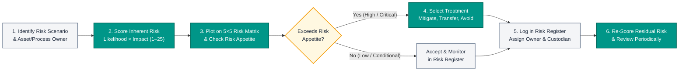

# 1.L.2 Risk Matrix and Risk Register #

# 1.L.2 Lab: Risk Matrix and Risk Register

## Lab Objectives
By the end of this lab, you will be able to:
1. Calibrate a **5×5 Qualitative/Semi-Quantitative Risk Matrix** with clear scoring thresholds aligned to organizational risk appetite.
2. Distinguish between **Inherent Risk**, **Risk Treatment**, and **Residual Risk**.
3. Build and populate an executive-ready **Cybersecurity Risk Register** using proper governance roles (distinguishing **Risk Owners** from **Control Custodians**).
## Part 1: Conceptual Foundation & Workflow

A **Risk Matrix** and a **Risk Register** are complementary governance instruments:
* **Risk Matrix (Visual Prioritization):** A 5×5 grid that maps **Likelihood** against **Impact** to categorize risk severity at a glance and establish escalation thresholds.
* **Risk Register (Operational Accountability):** A living governance log used to record, score, assign ownership, track treatment plans, and monitor **residual risk** over time.

### 1.1 Standardized 5×5 Risk Matrix
Each cell multiplies **Likelihood (1–5) × Impact (1–5)** to produce a score from **1 to 25**:

| Likelihood \ Impact | 1 – Negligible | 2 – Minor | 3 – Moderate | 4 – Major | 5 – Catastrophic |
| :--- | :---: | :---: | :---: | :---: | :---: |
| **5 – Almost Certain** | 5 (Medium) | 10 (High) | 15 (Critical) | 20 (Critical) | 25 (Critical) |
| **4 – Likely** | 4 (Low) | 8 (Medium) | 12 (High) | 16 (Critical) | 20 (Critical) |
| **3 – Possible** | 3 (Low) | 6 (Medium) | 9 (Medium) | 12 (High) | 15 (Critical) |
| **2 – Unlikely** | 2 (Low) | 4 (Low) | 6 (Medium) | 8 (Medium) | 10 (High) |
| **1 – Rare** | 1 (Low) | 2 (Low) | 3 (Low) | 4 (Low) | 5 (Medium) |

> **Governance Thresholds & Risk Appetite:**
> * 🔴 **Critical (15–25):** Exceeds risk appetite: requires immediate executive escalation and emergency mitigation.
> * 🟠 **High (10–14):** Above risk appetite: requires prioritized remediation plan and senior management sign-off.
> * 🟡 **Medium (5–9):** Within conditional tolerance: monitor closely and implement cost-effective controls.
> * 🟢 **Low (1–4):** Within risk appetite: acceptable; maintain baseline controls.

*(Note: A **Rare (1) × Catastrophic (5)** event such as a targeted nation-state attack scores **5 (Medium)** mathematically, yet organizations often apply an **executive override** so any Catastrophic impact triggers mandatory continuity planning.)*

## Part 2: Reference Cybersecurity Risk Register

This register separates **Inherent Risk** from **Residual Risk**, assigns **Business Risk Owners** rather than placing every risk on the CISO, and records an explicit **Risk Treatment** option.

| Risk ID | Threat & Vulnerability Scenario | Inherent L | Inherent I | Inherent Score | Existing Controls | Risk Treatment | Mitigation / Action Plan | Risk Owner | Residual L | Residual I | Residual Score | Status & Review Date |
| :--- | :--- | :---: | :---: | :---: | :--- | :--- | :--- | :--- | :---: | :---: | :---: | :--- |
| **R-001** | **Phishing** exploiting lack of user awareness leads to credential theft | 4 | 4 | **16** 🔴 Critical | Email gateway filtering, basic spam rules | **Mitigate** | Enforce FIDO2/MFA + monthly phishing simulations | VP of HR & Operations | 2 | 3 | **6** 🟡 Medium | In Progress (`2026-12-15`) |
| **R-002** | **Unpatched internet-facing server** exploited for remote code execution | 5 | 5 | **25** 🔴 Critical | Monthly manual patch cycle | **Mitigate** | Deploy automated patch management (48h SLA for critical CVEs) | Head of IT Infrastructure | 2 | 4 | **8** 🟡 Medium | Planning (`2026-12-01`) |
| **R-003** | **Insider data leakage** due to excessive permissions on finance shares | 2 | 5 | **10** 🟠 High | RBAC, basic access logging | **Mitigate** | Enforce DLP policies + quarterly user access reviews | CFO (Finance Data Owner) | 1 | 4 | **4** 🟢 Low | Completed (`2026-11-10`) |
| **R-004** | **Ransomware via removable media** bypassing endpoint protections | 3 | 4 | **12** 🟠 High | Endpoint AV, partial USB policy | **Mitigate** | Block USB mass storage via GPO + application allowlisting | Operations Director | 1 | 4 | **4** 🟢 Low | In Progress (`2026-12-20`) |

## Part 3: Hands-On Lab Exercises

### Task 1: End-to-End Walkthrough (Worked Example)
**Scenario:** A regional logistics company identifies the risk of **ransomware encrypting its ERP dispatch database**.
1. **Assess Inherent Risk:** Without offline backups or network segmentation, an attack is **Likely (4)** and downtime beyond 12 hours would be **Catastrophic (5)**.
   $$\text{Inherent Risk Score} = 4 \times 5 = 20 \text{ (Critical)}$$
2. **Assign Governance Roles:**
   * **Risk Owner:** Chief Operating Officer (COO) — owns the business impact of dispatch downtime.
   * **Control Custodian:** IT Security & Infrastructure Manager — implements technical safeguards.
3. **Select Treatment & Controls:** Choose **Mitigate** — implement immutable offline backups, micro-segmentation around the ERP database, and quarterly tabletop restoration drills.
4. **Calculate Residual Risk:** After verification, likelihood drops to **Unlikely (2)** and impact drops to **Major (4)** because rapid restoration limits business failure:
   $$\text{Residual Risk Score} = 2 \times 4 = 8 \text{ (Medium — within risk appetite)}$$

### Task 2: Your Turn (Complete the Register Entry)
A cloud SaaS company relies on a single third-party payment processor whose API lacks automated failover. An outage during peak sales would halt all checkout transactions.
1. Determine realistic **Inherent Likelihood** and **Inherent Impact** ratings (1–5) and calculate the **Inherent Risk Score**.
2. Choose the primary **Risk Treatment** (*Mitigate, Transfer, Avoid,* or *Accept*) and propose one concrete control or contractual safeguard.
3. Identify the proper **Risk Owner** using a managerial governance lens.
4. Estimate the **Residual Risk Score** after your treatment is applied.

### Task 2: Model Solution
1. **Inherent Risk:** Likelihood **3 (Possible)** × Impact **5 (Catastrophic)** = **15 (Critical)** *(exceeds risk appetite)*.
2. **Risk Treatment:** **Mitigate** — deploy an automated secondary payment gateway failover with health checks and run pre-peak load testing (optionally paired with **Transfer** via SLA penalties).
3. **Governance Roles:**
  * **Risk Owner:** VP of Commerce / CFO *(owns checkout revenue continuity)*.
  * **Control Custodian:** VP of Engineering / Payments Lead *(implements and tests failover)*.
4. **Residual Risk:** Likelihood **2 (Unlikely)** × Impact **2 (Minor)** = **4 (Low)** *(within risk appetite)*.

| Risk ID | Scenario | Inherent (L×I) | Treatment & Action Plan | Risk Owner | Residual (L×I) |
| :--- | :--- | :---: | :--- | :--- | :---: |
| **R-005** | Single payment processor API outage halts peak checkout | **15** 🔴 Critical (`3×5`) | **Mitigate:** Secondary gateway failover, automated health checks, peak load tests | VP of Commerce / CFO | **4** 🟢 Low (`2×2`) |

## Key Takeaways
* **Matrices simplify; Registers govern:** A heat map communicates risk posture to leadership quickly, while the risk register enforces accountability and auditability.
* **Risk matrices have blind spots:** Equal scores (e.g., `4 × 2 = 8` vs. `2 × 4 = 8`) do not represent identical business realities; high-impact, low-likelihood risks require qualitative executive review.
* **Security advises; Business owns:** Avoid assigning the CISO as the default Risk Owner for operational or business-process risks.