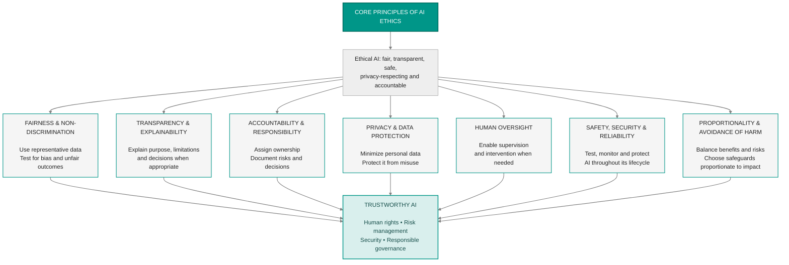

## 1.1.1 ISC2 Code of Professional Ethics

Ethics refer to a **set of moral principles that guide individuals or groups in determining what is right or wrong**, good or bad, in a given situation. They often encompass values such as `honesty`, `fairness`, `integrity`, and `respect for others`. Many professional bodies like ISC2 have established codes of ethics that members must adhere to, ensuring ethical conduct in their respective fields.

> ℹ  All CISSP candidates must understand and integrate these ethics into their professional practice both before and after taking the exam, as they serve as guiding principles. 
 
>🔗 *The information in the following comes from: https://www.isc2.org/ethics.*
>
>*All information security professionals who are certified by ISC2 recognize that such certification is a privilege that must be both earned and maintained. In support of this principle, all ISC2 members are required to commit to fully support this Code of Ethics (the "Code"). ISC2 members who intentionally or knowingly violate any provision of the Code will be subject to action by a peer review panel, which may result in the revocation of certification. ISC2 members are obligated to follow the ethics complaint procedure upon observing any action by an ISC2 member that breaches the Code. Failure to do so may be considered a breach of the Code pursuant to Canon IV. There are only four mandatory canons in the Code. By necessity, such high-level guidance is not intended to be a substitute for the ethical judgment of the professional.*

>**Code of Ethics Preamble:**
*The safety and welfare of society and the common good, duty to our principals, and duty to each other, require that we adhere, and be seen to adhere, to the highest ethical standards of behavior.
Therefore, strict adherence to this Code is a condition of certification.*
 
>**Code of Ethics Canons:**
>1. Protect society, the common good, necessary public trust and confidence, and the infrastructure.
>2. Act honorably, honestly, justly, responsibly, and legally.
>3. Provide diligent and competent service to principals.
>4. Advance and protect the profession.

> ℹ In his daily professional conduct, a genuine manager adheres to ethics canons, principles, and policies in descending order of importance. He frequently drafts ethical codes, principles, and policies to enable company personnel to seamlessly integrate them into their regular business practices.

> ℹ A code of ethics is usually designed to provide general direction rather than address specific technical situations.

>✓ Technical skills build systems. Ethics keep them worthy of trust.

(ISC)² has a formal, serious process for handling complaints, ensuring that the integrity of the certification and the trust in the profession are maintained.

The process is designed to be fair, thorough, and confidential. Here’s the key flow:

1. Filing a Complaint:
- Anyone can file a complaint including members of the public, employers, colleagues, or other (ISC)² members.
- The complaint must be in writing and specific.
- Anonymous complaints are generally not accepted.

2. Initial Review:
- The (ISC)² Ethics Committee reviews whether the complaint falls under its jurisdiction and whether it contains enough information to proceed.
- If the complaint is clearly frivolous or outside of ethics matters, it can be dismissed at this early stage.

3. Notification:
- If the complaint proceeds, the accused (called the respondent) is notified and given a chance to respond.
- This preserves due process — the right to defend oneself.

4. Investigation and Hearing:
- The Ethics Committee may investigate further if needed, gathering evidence.
- In complex cases, a formal hearing may be convened.

5. Decision and Sanctions:
- If the member is found to have violated the Code, the Committee decides on sanctions.
- Sanctions can include:
-- Private reprimand
-- Public reprimand
-- Suspension of certification
-- Revocation of certification

6. Appeal:
- The member has a right to appeal the decision within a specified timeframe.
- Appeals are typically reviewed by a separate (ISC)² committee.
### Open Questions ###

1. What are ethics, and how do they relate to professional organizations like ISC²?

  
Show answer

Ethics are moral principles that guide behavior and define right and wrong. Professional organizations like ISC² establish codes of ethics to ensure ethical conduct among their members.  

2. Explain the purpose of the ISC² Code of Ethics complaint procedure.

  
Show answer

ISC² members who intentionally violate the Code of Ethics may face disciplinary action from a peer review panel, including potential revocation of their certification. 

3. Explain the purpose of the ISC² Code of Ethics complaint procedure

  
Show answer

The complaint procedure allows members to report suspected ethical breaches by other members, ensuring accountability and upholding the integrity of the Code.

4. Why are the four canons in the ISC² Code of Ethics considered high-level guidance?

  
Show answer

The four canons offer broad guidelines that require individual ethical judgment and interpretation to apply to specific situations.

5. Summarize the main idea expressed in the ISC² Code of Ethics Preamble.

  
Show answer

The Preamble emphasizes the importance of ethical behavior for the safety and well-being of society, individuals, and the profession itself.

6. According to the first canon, what are ISC² members obligated to protect?

  
Show answer

ISC² members are obligated to protect society, the common good, public trust and confidence, and critical infrastructure.

7. What values are emphasized in the second canon of the ISC² Code of Ethics?

  
Show answer

The second canon stresses the values of honor, honesty, justice, responsibility, and legality in all professional actions.

8. What responsibility do ISC² members have towards their principals according to the third canon?

  
Show answer

ISC² members must provide diligent and competent service to their principals, demonstrating professionalism and commitment to their clients' needs

9. What is the significance of the fourth canon in relation to the information security profession?

  
Show answer

The fourth canon emphasizes the continuous development and protection of the information security profession through knowledge sharing and ethical practice.

10. How does adherence to the ISC² Code of Ethics benefit both individuals and the profession as a whole?

  
  
Show answer

Adherence to the Code upholds the reputation of the profession, builds trust among stakeholders, and ensures ethical and responsible conduct, ultimately benefiting both individuals and the collective.

---

## 1.1.2 Organizational code of ethics

The framework for ethical computing practice provided by the Computer Ethics Institute has been extensively employed in formulating acceptable use policies and educating users about the proper utilization of computing resources. 

> 🔗 As a leader in the field, the Computer Ethics Institute has provided an advanced forum and resource for identifying, assessing and responding to ethical issues associated with the advancement of information technologies in society: https://computerethics.institute/

>ℹWithin the Computer Ethics Institute's guidelines, known as "The Ten Commandments of Computer Ethics," the following principles are outlined:
>
>1. Thou shalt not use a computer to harm other people.
>2. Thou shalt not interfere with other people’s computer work.
>3. Thou shalt not snoop around in other people’s computer files.
>4. Thou shalt not use a computer to steal.
>5. Thou shalt not use a computer to bear false witness.
>6. Thou shalt not copy or use proprietary software for which you have not paid.
>7. Thou shalt not use other people’s computer resources without authorization orproper compensation.
>8. Thou shalt not appropriate other people’s intellectual output.
>9. Thou shalt think about the social consequences of the program you are writing or the system you are designing.
>10. Thou shalt always use a computer in ways that ensure consideration and respect for your fellow humans.

The IEEE Code of Ethics is a set of principles and professional standards established by the Institute of Electrical and Electronics Engineers (IEEE) to guide the ethical behavior of its members and those in related professions. It is designed to ensure integrity, accountability, and fairness in professional activities while promoting the welfare of society

> 🔗 The information in the following comes from: https://www.ieee.org/about/corporate/governance/p7-8.html

>ℹWe, the members of the IEEE, in recognition of the importance of our technologies in affecting the quality of life throughout the world, and in accepting a personal obligation to our profession, its members and the communities we serve, do hereby commit ourselves to the highest ethical and professional conduct and agree:
>
>I. To uphold the highest standards of integrity, responsible behavior, and ethical conduct in professional activities.
>
>1. to hold paramount the safety, health, and welfare of the public, to strive to comply with ethical design and sustainable development practices, to protect the privacy of others, and to disclose promptly factors that might endanger the public or the environment;
>2. to improve the understanding by individuals and society of the capabilities and societal implications of conventional and emerging technologies, including intelligent systems;
>3. to avoid real or perceived conflicts of interest whenever possible, and to disclose them to affected parties when they do exist;
>4. to avoid unlawful conduct in professional activities, and to reject bribery in all its forms;
>5. to seek, accept, and offer honest criticism of technical work, to acknowledge and correct errors, to be honest and realistic in stating claims or estimates based on available data, and to credit properly the contributions of others;
>6. to maintain and improve our technical competence and to undertake technological tasks for others only if qualified by training or experience, or after full disclosure of pertinent limitations;
>   
>II. To treat all persons fairly and with respect, to not engage in harassment or discrimination, and to avoid injuring others.
>
>7. to treat all persons fairly and with respect, and to not engage in discrimination based on characteristics such as race, religion, gender, disability, age, national origin, sexual orientation, gender identity, or gender expression;
>8. to not engage in harassment of any kind, including sexual harassment or bullying behavior;
>9. to avoid injuring others, their property, reputation, or employment by false or malicious actions, rumors or any other verbal or physical abuses;
>    
>III. To strive to ensure this code is upheld by colleagues and co-workers.
>
>10. to support colleagues and co-workers in following this code of ethics, to strive to ensure the code is upheld, and to not retaliate against individuals reporting a violation.

**RFC 1087** is titled **"Ethics and the Internet"**. It was published at a time when the internet (then called the ARPANET) was primarily used for academic, research, and governmental purposes. Its purpose was to clearly define unethical and unacceptable behavior by users of the network, especially those who would interfere with its function, misuse its resources, or compromise its mission. The core message of RFC 1087 is that the Internet is a privileged resource built for the advancement of research and education. Anyone using it must uphold ethical conduct and avoid activities that undermine the network or its community. RFC 1087 considers the following behaviors unethical:
- Unauthorized access to network resources
- Disruption of the intended use of the network
- Waste of resources, such as bandwidth or processing power
- Destruction or alteration of information
- Compromise of privacy of users

> ℹ For organizations, establishing an **internal ethical standard** provides employees with a `clear moral compass` while offering customers a genuine promise of integrity, turning organizational values into a real competitive advantage.
### Open Questions 
###
1. What is the primary function of the Computer Ethics Institute's "Ten Commandments of Computer Ethics"?

  
Show answer

The "Ten Commandments of Computer Ethics" serve as guidelines for ethical computer use, helping to establish acceptable use policies and educating individuals on responsible utilization of computing resources. 

2. How does the IEEE Code of Ethics promote societal well-being in relation to technological advancements?

  
Show answer

The IEEE Code of Ethics promotes societal well-being by emphasizing ethical design, sustainable development practices, and the consideration of societal implications, ensuring technology benefits humanity. 

3. According to the "Ten Commandments of Computer Ethics," what obligation do individuals have regarding software ownership?

  
Show answer

The guidelines state individuals should not copy or use proprietary software without proper payment, respecting intellectual property rights and legal ownership.

4. Explain the concept of "intellectual output" and its protection as outlined in the Computer Ethics Institute's guidelines.

  
Show answer

"Intellectual output" refers to creative works and ideas generated by individuals. The guidelines emphasize respecting ownership and prohibiting appropriation without permission or proper compensation.

5. Why is it crucial for computer professionals to consider the societal consequences of their work, as emphasized by the Computer Ethics Institute?

  
Show answer

Considering societal consequences is crucial to ensure technology is used responsibly, minimizing negative impacts and maximizing positive contributions to society.

6. What commitment does the IEEE Code of Ethics make regarding the safety and well-being of the public?

  
Show answer

The IEEE Code of Ethics prioritizes the safety, health, and welfare of the public above all else, urging members to consider potential risks and act responsibly.

7. How does the IEEE Code of Ethics address the issue of potential conflicts of interest in professional settings?

  
Show answer

The code mandates disclosing any real or perceived conflicts of interest to affected parties, promoting transparency and ethical decision-making.

8. Explain the importance of honest criticism and acknowledging errors within the framework of the IEEE Code of Ethics.

  
Show answer

Honest criticism and acknowledging errors fosters improvement and knowledge sharing within the profession, contributing to overall progress and accountability.

9. How does the IEEE Code of Ethics promote fairness and inclusivity in professional environments?

  
Show answer

The code explicitly prohibits discrimination and harassment based on various characteristics, ensuring a fair and inclusive environment for all individuals.

10. What responsibility do IEEE members have towards upholding the code of ethics among their colleagues and coworkers?

  
  
Show answer

IEEE members are obligated to support colleagues in upholding the code and to report any violations without fear of retaliation, fostering a culture of ethical conduct.

## 1.1.3 Ethics in Artificial Intelligence (AI)

Artificial Intelligence (AI) is changing how organizations make decisions, manage information, protect systems, and, more in general, deliver services. AI can improve efficiency, support  analysis, detect threats, and much more. However, these benefits also introduce ethical concerns that must be addressed. 

`AI ethics concerns the principles and responsibilities that guide the design, development, deployment, and use of AI systems`. It asks whether an AI system is fair, transparent, safe, secure, respectful of privacy, and accountable for its effects on people and society.

>⚠ An AI system should not be considered ethical simply because it produces accurate results or complies with technical requirements. An organization must also consider how the system reaches its conclusions, which data it uses, who may be affected by its decisions, whether those decisions can be challenged, and who is accountable when something goes wrong.

>⚠ AI must be governed as part of the organization's overall risk management program.

The core principles of AI ethics are:
 1. **Fairness and Non-Discrimination**. AI systems learn patterns from data or apply rules and models to information. `If the data reflects historical discrimination, incomplete representation, or existing social inequalities, an AI system may reproduce or amplify those problems`. The EU Artificial Intelligence Act establishes specific requirements for certain AI systems, including requirements relating to data governance and the management of risks associated with high-risk systems. The OECD AI Principles also emphasize human rights, fairness, inclusion, and non-discrimination.
 2. **Transparency and Explainability.** Transparency means `providing appropriate information about an AI system, its intended purpose, its limitations, and how it is used`. Explainability concerns the `ability to understand why a system produced a particular result or recommendation.` Under Article 50 of the EU AI Act, certain AI systems are subject to specific transparency obligations. These include requirements concerning informing people when they interact with AI in covered circumstances and requirements relating to certain AI-generated or manipulated content. The exact obligation depends on the type of system, the role of the provider or deployer, applicable exceptions, and the relevant implementation dates
 3. **Accountability and Responsibility**. Accountability means that `identifiable people or organizations remain responsible for decisions concerning AI systems and their consequences`. An AI system cannot take legal or organizational responsibility away from the people and entities that design, approve, deploy, or operate it. Responsibility `may be distributed among several parties`. A provider may develop the model, a supplier may provide the underlying technology, an organization may integrate it into a business process, and an employee may use its output to make a decision. Each party may have different responsibilities under contracts, organizational policies, and applicable laws.
 4. **Privacy ad Data Protection**. AI systems may process large quantities of personal, confidential, or sensitive information. This creates risks involving unauthorized disclosure, excessive collection, inappropriate secondary use, re-identification, and retention beyond the original purpose. Appropriate safeguards may include data minimization, pseudonymization, encryption, access restrictions, secure development practices, privacy impact assessments, and testing for unintended disclosure.
 5. **Human Oversight**. Human oversight means `ensuring that people can appropriately supervise AI systems and intervene when necessary.` Organizations should define when human review is required, what information reviewers need, how decisions can be challenged, and when the system must be stopped or overridden. The level of oversight should reflect the risks associated with the intended use.
 6. **Safety, Security and Reliability**. An AI system may produce harmful results because of technical defects, inadequate training data, unexpected inputs, malicious manipulation, or inappropriate use. Security controls must reflect the specific architecture and threat model. Depending on the system, appropriate safeguards may include strong authentication, least privilege, network segmentation, secure development, input validation, output filtering, logging, monitoring, and incident response procedures.
 7. **Proportionality and Avoidance of harm**. Organizations should consider whether AI is necessary, whether a less intrusive alternative could achieve the same objective, and whether the proposed use could cause avoidable harm.

The following picture recaps all this:

**Bias** is a `systematic distortion that may affect the outcomes of an AI system`. It can originate in the training data, the way information is collected, the selection of variables, the design of the model, the objectives used for optimization, or the context in which the system is deployed. Organizations should assess the origin and quality of data, test model performance across relevant populations, document known limitations, and monitor outcomes after deployment. Testing should be appropriate to the system's intended purpose and the risks it creates.

ℹ There is no single statistical measure that proves a system is fair in every context. Different fairness measures can conflict, and the appropriate evaluation depends on the decision, the population, the consequences of errors, and applicable legal requirements.

Generative AI systems can create text, images, audio, video, software code, and other content. These capabilities introduce risks involving misinformation, impersonation, intellectual property, confidentiality, and the reliability of generated information. `A generated response may be plausible without being correct`. This is commonly described as a **hallucination**. If an organization relies on generated content without appropriate verification, errors may enter business decisions, security reports, legal documents, or customer communications.

> 🔗 The [NIST Artificial Intelligence Risk Management Framework](https://www.nist.gov/itl/ai-risk-management-framework), published in 2023 as AI RMF 1.0, provides a voluntary approach for managing AI risks throughout the system lifecycle. It organizes its core activities into four functions: Govern, Map, Measure, and Manage. These functions are complementary and are not intended to be treated as a rigid, one-time sequence.

> 🔗 [ISO/IEC 42001:2023](https://www.iso.org/standard/42001) specifies requirements for an Artificial Intelligence Management System (AIMS). It provides a management-system approach for establishing, implementing, maintaining, and continually improving organizational processes for AI. It supports defined responsibilities, risk assessment, operational controls, performance evaluation, and continual improvement.

> 🔗 [The EU AI Act](https://artificialintelligenceact.eu/), establishes a legal framework for AI based on risk. It distinguishes prohibited AI practices, high-risk AI systems, AI systems subject to specific transparency obligations, and other systems that may have fewer obligations under the Act.