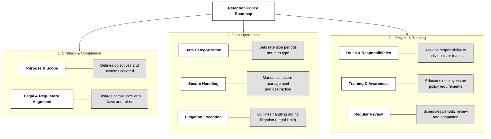

## 2.5.1 Asset management policy ##

An organization cannot protect what it does not properly manage. An asset management policy establishes the rules for identifying, classifying, tracking, protecting, maintaining, and eventually disposing of the organization's assets. These assets are not limited to computers and servers: they include information, applications, databases, network equipment, cloud services, physical records, and other resources that support business operations. The policy should define its purpose and scope, assign clear responsibilities to asset owners and custodians, establish classification and handling requirements, and explain how assets are recorded and monitored throughout their lifecycle. It should also address legal and regulatory obligations, acceptable use, periodic reviews, and employee awareness. For example, when a company introduces a new cloud application, the application should be identified, assigned an owner, classified according to the information it handles, and included in the organization's asset inventory. Without clear ownership and reliable records, security teams may overlook systems, apply inconsistent controls, or fail to identify who is accountable when something goes wrong.

ℹ **ISO 15489-1:2016** is an international standard for records management that provides guidelines on how organizations should create, manage, and maintain records throughout their lifecycle, ensuring they are accessible, authentic, and reliable. It defines the principles and practices of records management, emphasizing the need for a structured approach to organizing, preserving, and disposing of records in both physical and digital formats. The standard aims to help organizations ensure compliance with legal, regulatory, and operational requirements related to records management.

> ℹ  **DoD Instruction 5015.02** is a directive from the U.S. Department of Defense that establishes policies and procedures for records management within the DoD. It provides a framework for the creation, maintenance, and disposition of records, ensuring that all DoD components comply with federal regulations and guidelines for managing records. The instruction ensures that records are properly preserved, accessible, and disposed of in accordance with legal and operational needs.
## 2.5.2 Asset retention ##

Asset retention is about `keeping information and records for as long as they are genuinely needed` and not simply storing everything forever. Organizations must balance business needs, legal and regulatory obligations, historical value, and security risks. 
A retention policy defines 
- what must be retained
- where it should be stored
- who can access it
- when it must be securely destroyed. 

**Retention schedules** should distinguish between different types of information: financial records, employee files, customer information, security logs, contracts, and operational records may all have different retention periods. 
The policy should also define responsibilities, secure handling procedures, employee training, periodic reviews, and a process for placing a legal hold on information that may be relevant to litigation or an investigation. 

A **legal hold** suspends normal deletion procedures for the information concerned, even if its scheduled retention period has expired. Keeping information can support business continuity, investigations, audits, and organizational knowledge. However, retaining data longer than necessary increases storage and protection costs, expands the amount of information exposed in a breach, and may create additional legal or privacy risks. 

Hardware also has a retention lifecycle: organizations should monitor vendor End of Life (EOL) and End of Support (EOS) dates. EOL generally means the vendor has stopped producing or marketing a product, while EOS means support has ended. A system that no longer receives security patches may become increasingly difficult to protect, even if it still works perfectly well.

## 2.5.3  Asset Retirement ##

Every asset eventually reaches the end of its useful life. Asset retirement is the `controlled process of removing an asset from active use while ensuring that business operations, sensitive information, and security controls are not compromised`. Retirement should begin with authorization and an update to the asset inventory. The organization must determine whether the asset contains information that needs to be retained, transferred, archived, or destroyed. 

Before hardware is reused, sold, donated, returned to a supplier, or discarded, its storage media must undergo appropriate data **sanitization**. Simply deleting files, formatting a disk, or reinstalling an operating system does not guarantee that the original information cannot be recovered. Depending on the sensitivity of the data and the intended reuse of the device, sanitization may involve approved overwriting, cryptographic erasure, or physical destruction. When information is highly sensitive or the media cannot be reliably sanitized, physical destruction may be necessary. Organizations should also revoke associated accounts, credentials, certificates, network access, licenses, and remote connections, and remove the asset from monitoring and management systems where appropriate. **Decommissioning records** should `document the asset, authorization, sanitization method, date, and final destination`. If disposal is outsourced, the organization should obtain suitable evidence from the service provider and maintain chain-of-custody records where required. 

> ⚠ An old server left connected to the network or a discarded laptop containing recoverable customer data can become a security incident long after the asset has stopped being useful.

### Open Questions ###

1. What is asset retention?

  
Show answer

Asset retention means keeping and managing all of an organization's data—whether digital records, physical documents, hardware, or even user access rights—in a way that balances what’s necessary to preserve and what should be securely disposed of when no longer needed.

2. Why does a retention policy matter beyond storage?

  
Show answer

A well-crafted retention policy acts as a strategic roadmap for how data is handled through its entire lifecycle—from creation to destruction. It ensures legal compliance, supports operational continuity, protects institutional memory, and securely disposes of data when it's no longer useful.

3. What must a comprehensive retention policy include?

  
Show answer

It should define its purpose and scope clearly; align with laws and regulations; categorize data with specific retention schedules; enforce secure handling and destruction; incorporate litigation hold procedures; assign roles and responsibilities; train staff; and ensure regular policy review and updates.

4. What are the benefits of a solid retention policy?

  
Show answer

It minimizes legal and financial risk, helps maintain business operations during disruptions, preserves valuable historical insights, and supports forensic investigations—all while avoiding the high costs and risks of unnecessary data storage or outdated hardware.

5. Why is secure decommissioning essential for hardware?

  
Show answer

Proper hardware decommissioning—through data sanitization, physical destruction of storage devices, and inventory tracking—prevents accidental data leakage and ensures outdated or end-of-support equipment doesn’t leave an organization exposed.

