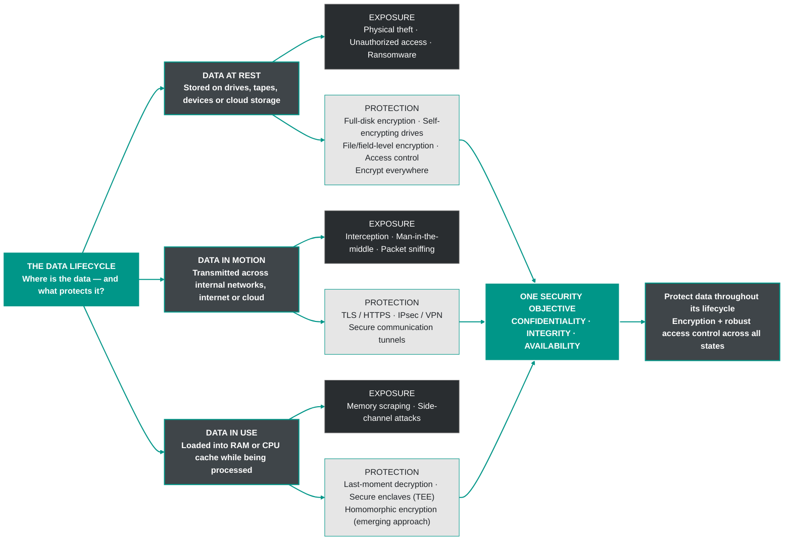
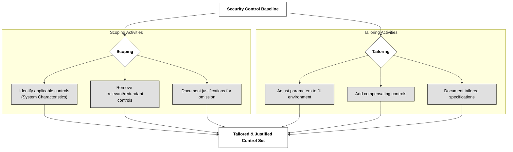
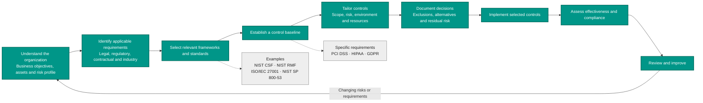

# 2.6 Determine data security controls and compliance requirements
## 2.6.1 Data States ##

Data can exist in three states: data at rest, data in motion, and data in use. Each state presents unique security challenges and requires different protection mechanisms.

> ✓ For each data state, you must ensure its Confidentiality, Integrity, and Availability.

**Data at rest** refers to data that is `stored on a device or in a storage medium`, such as hard drives, solid-state drives, backup tapes, or cloud storage. This data is not actively being used or transmitted, making it a prime target for attackers who gain physical access to the storage device or compromise the system remotely. **Encryption is the most effective way to protect data at rest**. By encrypting data, even if an attacker gains access to the storage device, they cannot read the data without the encryption key.. Modern operating systems and third-party software offer encryption solutions for individual files, entire volumes, or even whole-disk encryption. 

Organizations should have policies requiring encryption of sensitive data, such as personally identifiable information (PII) and protected health information (PHI). Encrypting all data stored anywhere, an **encrypt everywhere** approach, mitigates the risk of accidental storage of sensitive information in unencrypted volumes.

Examples of data at rest protection measures include:
1. Full disk encryption: Encrypting an entire hard drive volume.
2. Self-encrypting drives (SEDs): Hard drives or solid-state drives that automatically encrypt and decrypt data without additional software.
3. File-level encryption: Encrypting individual files.
4. Field-level encryption: Encrypting specific data fields within a file.
5. Access control: Restricting physical and logical access to storage devices and systems.

**Data in motion**, also known as **data in transit** or data in flight, refers to data that is `being transmitted over a network`. This includes data transmitted over internal networks, the internet, and to the cloud. 
Data in motion is particularly vulnerable as it travels outside the protected confines of networks and can be intercepted by attackers. Strong encryption, such as Transport Layer Security (TLS) and IPSec, is crucial for protecting data in motion. TLS uses digital certificates to authenticate the server, while IPSec provides secure connections between networks or devices. Data in motion is usually encrypted by:
1. Transport Layer Security (TLS): A cryptographic protocol that secures communications over the internet, commonly used for HTTPS websites.
2. IPSec: A suite of protocols that provide secure communication between devices or networks, often used for VPNs.
3. Virtual Private Networks (VPNs): Create secure connections between remote users and corporate resources or between geographically dispersed networks, providing secure communication over untrusted networks like the internet.

**Data in use** refers to data that is `actively being processed by an application or system and is temporarily stored in volatile memory, such as RAM, CPU caches, or registers`. Protecting data in use is challenging because it needs to be decrypted before processing, making it vulnerable to attacks that target the system's memory. While encryption cannot directly protect data in use, strategies like decrypting data at the last moment before processing and encrypting it as soon as it leaves the CPU registers can enhance security. However, this approach is computationally expensive and requires specialized hardware, such as cryptographic co-processors.
Emerging technologies, such as homomorphic encryption, offer promising solutions for protecting data in use. Homomorphic encryption allows computations on encrypted data without decryption, meaning the data remains encrypted throughout the processing. Although not yet practical for widespread use, advancements in homomorphic encryption could revolutionize data security in the future. Homomorphic encryption enables computations on encrypted data without decryption, preserving data confidentiality throughout processing.

**Side-channel attacks** pose a significant threat to data in use. These attacks exploit information leaked by a cryptosystem, such as power consumption or processing time, to deduce sensitive information, including encryption keys. For example, the Heartbleed vulnerability demonstrated how attackers could exploit memory vulnerabilities to access sensitive data from other processes running on the same system. Similarly, attacks like Meltdown, Spectre, and BranchScope leverage hardware features in modern CPUs to exploit memory access patterns and steal data in use.

> ℹ Audio data can be kept private by using headphones to prevent eavesdropping, while protecting written data often requires physical measures like protective screens or privacy filters.

The following table recaps what we have seen so far:

| Data State       | Definition                                                                                             | Risks                                                                 | Protection Measures                                                                                             |
|------------------|--------------------------------------------------------------------------------------------------------|------------------------------------------------------------------------|------------------------------------------------------------------------------------------------------------------|
| **At rest**      | Data stored on devices or storage media (e.g., drives, tapes, cloud) not currently moving or being used  | Physical theft, unauthorized system access, ransomware                | Full-disk encryption, self-encrypting drives, file/field-level encryption, access control, "encrypt everywhere" |
| **In motion**    | Data being transmitted over networks (internal, internet, or cloud)  | Interception, man-in-the-middle, packet sniffing                     | TLS/HTTPS, IPSec/VPN, secure communication tunnels                                                               |
| **In use**       | Data loaded into memory (RAM, CPU cache) while being processed  | Memory scraping, side-channel attacks                                | Last-moment decryption, secure enclaves (TEE), emerging approaches like homomorphic encryption                 |
| **Common goal** | Ensure **Confidentiality**, **Integrity**, and **Availability** (CIA triad) for every data state       | —                                                                      | Encryption and robust access control across all states                                                           |

### Open Questions ###

1. Explain the difference between data at rest and data in transit.

  
Show answer

Data at rest refers to data stored on a device or system and not actively being used. Data in transit is data that is actively being transmitted over a network.

2. List three methods of data encryption and briefly describe their scope of protection.

  
Show answer

Full-disk encryption: Encrypts an entire storage drive. 

File-level encryption: Encrypts individual files. 

Field-level encryption: Encrypts specific data fields within a file.

3. What is the primary purpose of using encryption as a security control?

  
Show answer

Encryption is primarily used to protect the confidentiality of data by making it unreadable without the proper decryption key. This prevents unauthorized access and disclosure of sensitive information.

4. Describe two technologies that can be used to secure data in transit.

  
Show answer

TLS (HTTPS) and VPNs are two common technologies used to secure data in transit. TLS encrypts data exchanged between web browsers and servers, while VPNs create secure, encrypted tunnels over public networks.

5. What is the main challenge associated with securing data in use?

  
Show answer

The main challenge with securing data in use is that data is typically decrypted in memory for processing, making it vulnerable to attacks.

6. What is a TPM and how can it be used for data security?

  
Show answer

A TPM is a hardware chip that provides secure storage of cryptographic keys and can be used for full-disk encryption. It helps authenticate the platform during boot-up, ensuring that the system hasn't been tampered with.

7. Differentiate between link encryption and end-to-end encryption.

  
Show answer

Link encryption encrypts data at each hop in a network path, while end-to-end encryption ensures that only the sender and the intended recipient can decrypt the data.

8. Briefly describe how a man-in-the-middle attack works.

  
Show answer

In a man-in-the-middle attack, the attacker intercepts communication between two parties and potentially impersonates one or both to gain access to sensitive information.

9. What is a side-channel attack, and why is it a concern for data security?

  
Show answer

A side-channel attack exploits information leakage from a system's physical implementation, like power consumption or timing differences. It can be used to infer sensitive data or compromise cryptographic keys.

10. What is homomorphic encryption, and what potential advantage does it offer?

  
Show answer

Homomorphic encryption allows computations to be performed on encrypted data without decryption. This has the potential to enable secure processing of sensitive data without compromising confidentiality.

---

## 2.6.2 Scoping and Tailoring ##

As a security expert, you play a crucial role in ensuring that security controls are not just implemented, but implemented effectively. This involves adapting general security recommendations from frameworks and guidelines to your organization's specific context. Two key processes in this adaptation are scoping and tailoring.

**Scoping** involves `determining which security controls are applicable to the systems and assets you need to protect`. It's about eliminating controls that are redundant or unnecessary for your environment. For instance, if your system doesn't allow concurrent logins, there's no need for a control addressing concurrent session management. Scoping demands careful consideration and documented justification for omitting any controls from the baseline.

**Tailoring**, on the other hand, focuses on `modifying the implementation of controls to align with the organization's specific requirements`. This might involve adjusting the control's parameters or substituting it with a compensating control that achieves a similar security outcome. Imagine an organization with a central office and a remote site. The baseline control set might work perfectly for the central office but prove impractical for the remote location. Tailoring allows for adjustments, such as implementing compensating controls, to address the unique circumstances of the remote site.

🔗 Scoping and tailoring were first introduced in [1.3 Evaluate, apply, and sustain security governance principles](../DOMAIN1%20-%20Security%20Governance%20and%20Risk%20Management/1.3%20Evaluate,%20apply,%20and%20sustain%20security%20governance%20principles.md)

Scoping and tailoring work hand in hand, first identifying relevant controls and then fine-tuning their implementation.

Key Considerations for Scoping and Tailoring:
1. **Organizational Mission and Objectives:** Security controls should support the organization's core functions and strategic goals.
2. **Risk Assessment:** The selection and modification of controls should be driven by a thorough understanding of the organization's risk profile, including threats, vulnerabilities, and impact assessments.
3. **Resource Constraints:** Consider the organization's budget, staffing, and technical capabilities when making decisions about scoping and tailoring.
4. **Operational Impact:** Evaluate how the chosen controls will affect the organization's day-to-day operations and ensure they do not create undue burdens.
5. **Documentation:** Meticulously document all scoping and tailoring decisions, including the rationale behind them. This documentation is essential for demonstrating compliance, facilitating audits, and ensuring continuity.

> ⚠  Convenience should never be the driving force behind removing or altering security controls. Any changes must be justified based on operational needs and their potential impact on risk. 

### Open Questions ###

1. What is the primary purpose of tailoring security controls?

  
Show answer

Tailoring security controls aims to customize a set of baseline security controls to align with an organization's specific security requirements, risk tolerance, and operational context. It ensures that the controls are effectively implemented and relevant to the organization's needs.

2. Explain the relationship between tailoring and an organization's mission.

  
Show answer

Tailoring ensures the chosen security controls align directly with the organization's mission. By considering the organization's goals and objectives, tailoring helps select controls that protect the most critical assets and processes, ensuring the organization can achieve its mission securely.

3. What is the key difference between scoping and tailoring in security control implementation?

  
Show answer

Scoping involves selecting the relevant security controls from a broader standard or baseline and eliminating those that are not applicable. Tailoring, on the other hand, involves modifying the selected controls to better address the organization's specific requirements and constraints.

4. Provide an example of a situation where compensating controls might be necessary in the tailoring process.

  
Show answer

Compensating controls might be necessary when a baseline control cannot be implemented in a specific environment. For example, if a remote office lacks the infrastructure for a specific control, a compensating control with equivalent security measures can be implemented.

5. Why is it important to document the decisions made during the scoping and tailoring process?

  
Show answer

Documenting scoping and tailoring decisions provides transparency and accountability for the security choices made. This documentation helps auditors understand the rationale behind the implemented controls and demonstrates compliance efforts.

6. If a baseline recommends a control that is already implemented more comprehensively, how should this be addressed during tailoring?

  
Show answer

If a control is already implemented more comprehensively than the baseline recommendation, this should be documented during tailoring. The organization can justify retaining the existing implementation, demonstrating that it meets or exceeds the baseline requirements.

7. What is the significance of "control value" in the context of tailoring?

  
Show answer

"Control value" refers to the specific parameter or setting of a security control. Tailoring may involve adjusting these values to align with the organization's risk tolerance and operational needs. For example, the number of allowed login attempts before an account lockout can be modified.

8. Why is it essential to rigorously defend decisions to omit controls from a baseline?

  
Show answer

Rigorously defending decisions to omit controls from a baseline is crucial to ensure that security risks are not overlooked. Organizations must provide clear and documented justification, demonstrating that alternative controls or risk mitigation strategies are in place.

9. In what scenario might a company need to scope a security standard received from a parent company?

  
Show answer

A company might need to scope a parent company's security standard if the subsidiary company has different policies or practices. For example, if the parent company allows BYOD (Bring Your Own Device) but the subsidiary company prohibits it, the BYOD sections would be removed during the scoping process.

---

## 2.6.3 Standards and Controls Selection ##

A security framework gives an organization a structured way to manage information security. It helps establish governance, define responsibilities, assess risks, and organize security activities. However, adopting a framework does not automatically make an organization secure or compliant.
Think of a framework as a roadmap, a standard as a set of defined requirements or practices, and a control as a specific safeguard implemented to reduce risk.

There is no single framework or standard that fits every organization. Selection should reflect the organization's business objectives, risk profile, information sensitivity, technology environment, industry, jurisdiction, contractual obligations, and available resources.

> ℹ Organizations can adopt an established framework, combine elements from multiple sources, and tailor the resulting control baseline. The objective is not to implement every control available; it is to select controls that address relevant risks and applicable requirements.

**NIST SP 800-37** describes the Risk Management Framework for managing security and privacy risks throughout the system lifecycle. It provides a structured process for categorizing systems, selecting and implementing controls, assessing their effectiveness, authorizing systems, and continuously monitoring them.

The **NIST CSF** helps organizations understand, assess, prioritize, and communicate cybersecurity risk. It is voluntary and can be used by organizations of different sizes and sectors.

The CSF 2.0 is organized around six functions:

- **Govern**: Establish and monitor cybersecurity risk-management strategy, expectations, and responsibilities.
- **Identify**: Understand the organization's assets, risks, and cybersecurity environment.
- **Protect**: Implement safeguards to reduce cybersecurity risk.
- **Detect**: Identify potential cybersecurity incidents.
- **Respond**: Take action when a cybersecurity incident occurs.
- **Recover**: Restore affected capabilities and services.

**ISO/IEC 27001** specifies requirements for establishing, implementing, maintaining, and continually improving an **Information Security Management System (ISMS)**. It requires an organization to assess and treat information security risks in a way that fits its context.
ISO/IEC 27002 complements it by providing guidance on information security controls and their implementation. In simple terms, ISO 27001 defines the requirements for the management system, while ISO 27002 helps organizations understand and apply security controls.

**NIST SP 800-53** provides a comprehensive catalog of security and privacy controls. Organizations use it to select, tailor, and implement controls according to their requirements and risk assessments.

**NIST SP 800-53A** provides assessment procedures for evaluating whether those controls are implemented correctly, operating as intended, and producing the desired results.

**FIPS 199** and **FIPS 200** are Federal Information Processing Standards support the protection of U.S. federal information systems.

- FIPS 199 provides a method for categorizing information and information systems according to the potential impact of a loss of confidentiality, integrity, or availability.
- FIPS 200 defines minimum security requirements for federal information systems and organizations.

Some requirements apply because of an organization's industry, activities, location, or contractual relationships.

Examples include:
- **PCI DSS**: Security requirements for entities that store, process, or transmit payment card account data.
- **HIPAA**: U.S. requirements for protecting certain health information handled by covered entities and business associates.
- **GDPR**: EU data protection regulation that applies to organizations and processing activities within its scope, including certain organizations outside the EU.

> ⚠ These requirements are not interchangeable with voluntary frameworks. An organization must identify which laws, regulations, contractual obligations, and industry requirements actually apply to its operations. For example, an organization processing payment card data may use ISO 27001 as its overall security management framework while also implementing the specific requirements of PCI DSS. Adopting ISO 27001 does not automatically demonstrate PCI DSS compliance.

A framework or standard provides a starting point, not a universal checklist. Organizations must adapt their security controls to their own circumstances.

This involves:

1. Identifying applicable legal, regulatory, contractual, and business requirements.
2. Understanding the information assets and their classification.
3. Assessing threats, vulnerabilities, risks, and business impact.
4. Selecting appropriate controls from relevant frameworks and standards.
5. Tailoring controls to the organization's environment and risk appetite.
6. Documenting justified exclusions, alternative controls, and residual risks.
7. Periodically reviewing the baseline as risks, technologies, and requirements change.

For example, a small organization handling public information may not need the same level of protection as a financial institution processing sensitive customer records. Both need appropriate security, but their control baselines should reflect their different risks and obligations.

> ✓ Select standards and controls based on business context, risk, and applicable requirements. A framework provides structure, a standard provides defined requirements or guidance, and controls provide the safeguards that protect the organization's assets.

### Open Questions ###

1. What is the difference between a security framework, a security standard, and a security control?

 
Show answer

A framework provides an overall structure for managing security, a standard defines requirements or recommended practices, and a control is a specific safeguard used to address a security risk. For example, ISO/IEC 27001 provides ISMS requirements, ISO/IEC 27002 provides control guidance, and MFA is a specific security control.

2. Why might an organization voluntarily adopt a recognized security framework even when it is not legally required to do so?

 
Show answer

A recognized framework provides a structured approach to identifying and managing security risks, improving consistency, and communicating security expectations to stakeholders. It can also help demonstrate the organization's commitment to sound security practices.

3. What factors should an organization consider when selecting a security framework or standard?

 
Show answer

The organization should consider its business objectives, risk profile, information sensitivity, industry, applicable laws and regulations, contractual obligations, technology environment, and available resources. The selected approach must be appropriate for its actual needs.

4. What is the primary purpose of the NIST Cybersecurity Framework (CSF)?

 
Show answer

The NIST CSF provides a flexible structure for understanding, assessing, prioritizing, and communicating cybersecurity risk. It can be used by organizations of different sizes and across different sectors.

5. What are the six core functions of NIST CSF 2.0, and what does each address?

 
Show answer

- Govern: Establish cybersecurity risk-management strategy and responsibilities.
    
- Identify: Understand assets, risks, and the organizational environment.
    
- Protect: Implement safeguards.
    
- Detect: Identify potential cybersecurity incidents.
    
- Respond: Take action to manage incidents.
    
- Recover: Restore affected services and capabilities.
    

6. What is the difference between NIST SP 800-53 and NIST SP 800-53A?

 
Show answer

NIST SP 800-53 provides a catalog of security and privacy controls that organizations can select and tailor. NIST SP 800-53A provides assessment procedures to evaluate whether those controls are properly implemented and operating as intended.

7. What is the purpose of ISO/IEC 27001, and what is an ISMS?

 
Show answer

ISO/IEC 27001 specifies requirements for establishing, implementing, maintaining, and continually improving an Information Security Management System. An ISMS is a systematic approach to managing information security risks through policies, processes, responsibilities, and controls.

8. How does ISO/IEC 27002 complement ISO/IEC 27001?

 
Show answer

ISO/IEC 27001 specifies the requirements for an ISMS, while ISO/IEC 27002 provides guidance on information security controls and their implementation. Together, they help organizations establish and operate a structured information security management approach.

9. An organization processes payment card data and already follows ISO/IEC 27001. Does this automatically mean it complies with PCI DSS? 

 
Show answer

No. ISO/IEC 27001 provides an information security management framework, but PCI DSS has its own specific requirements for protecting payment card account data. The organization must independently assess and meet the PCI DSS requirements applicable to its environment.

10. Why should an organization tailor its security control baseline instead of implementing every available control at the highest possible level?**

 
Show answer

Controls should be selected according to the organization's risks, asset value, business requirements, regulatory obligations, and resources. Applying every control at the highest level may be unnecessarily expensive, while insufficient controls can leave unacceptable risks unaddressed.

---
## 2.6.4 Data protection methods (e.g., Digital Rights Management (DRM), Data Loss Prevention (DLP), Cloud Access Security Broker (CASB)),Cloud-Native Application Protection Platform (CNAPP))

Encryption transforms readable information (plaintext) into an unintelligible form (ciphertext) using a cryptographic algorithm and key. Only parties with the appropriate decryption capability can recover the original information.

Encryption is commonly used to protect data:

- **At rest:** information stored on disks, databases, removable media, or cloud storage.
- **In transit:** information travelling across networks, such as through TLS-protected connections.
- **In use:** information being processed, using techniques such as confidential computing where appropriate.

Encryption primarily protects confidentiality. Its effectiveness depends on sound key management, access controls, and appropriate cryptographic implementation.

See also: [3.6 Select and determine cryptographic solutions](../DOMAIN3%20-%20Security%20Architecture%20and%20Engineering/3.6%20Select%20and%20determine%20cryptographic%20solutions.md).

**Data Loss Prevention** technologies help organizations prevent sensitive information from being disclosed, transferred, or used in ways that violate security policies. A DLP solution `identifies sensitive information, monitors its movement, and applies rules to prevent unauthorized activities`. It can recognize information such as credit card numbers, personal identifiers, health records, and intellectual property through techniques such as pattern matching, content inspection, classification labels, and contextual analysis.

DLP commonly protects data in three states:
- **Data at rest:** information stored in databases, file servers, endpoints, and cloud repositories. DLP can discover sensitive information and identify inappropriate storage or access.
- **Data in transit:** information moving across networks, email, web uploads, or other communication channels. DLP can detect and block unauthorized transfers.
- **Data in use:** information actively accessed or manipulated by users. Endpoint DLP can restrict activities such as copying sensitive files to USB devices, printing, or uploading information to unauthorized applications.

A typical DLP implementation follows three stages:
1. **Discovery and classification:** identify sensitive information and determine its classification.
2. **Monitoring:** inspect how information is accessed, used, and transferred.
3. **Enforcement:** apply policies through actions such as blocking, quarantining, encrypting, or alerting.

For example, an employee attempts to email a spreadsheet containing thousands of customer credit card numbers to a personal email account. DLP identifies the sensitive content and blocks the transfer, generating an alert for the security team.

DRM and IRM technologies control how digital content and information can be accessed and used.

**Digital Rights Management (DRM)** primarily `protects copyrighted or licensed digital content`. It helps content owners control distribution and usage through mechanisms such as:
- Digital licenses and usage restrictions.
- Authentication and authorization.
- Restrictions on copying, printing, or redistribution.
- Expiration dates and subscription-based access.
- Digital watermarking to help identify ownership or trace unauthorized distribution.
For example, a company distributing licensed training videos can use DRM to restrict playback to authorized users and prevent unrestricted copying.

**Information Rights Management (IRM)** applies similar principles to business information and documents. It `can restrict who may open, view, print, copy, forward, or modify sensitive files, even after they have been distributed.`
For example, a confidential financial report may be shared with senior managers but configured so that recipients cannot forward, print, or copy its contents.

> ℹ The key distinction is that DRM is commonly associated with protecting copyrighted digital content, while IRM focuses on controlling the use of organizational information.

Organizations increasingly use cloud services, sometimes without the security team's knowledge. Employees may store company documents in personal cloud accounts, use unauthorized file-sharing applications, or access SaaS services from unmanaged devices. A **Cloud Access Security Broker (CASB)** helps address these risks by providing visibility into cloud service usage and enforcing security policies between users and cloud applications.

CASB solutions commonly provide four capabilities:
- **Visibility:** identify cloud applications in use, including potentially unauthorized services (shadow IT).
- **Data security:** identify and protect sensitive information stored or shared through cloud services.
- **Threat protection:** detect suspicious activities, malware, compromised accounts, and risky user behavior.
- **Compliance:** help enforce security policies and support regulatory and organizational requirements.

CASB solutions can be deployed through three common approaches:

|Deployment model|How it works|Typical use|
|---|---|---|
|Forward proxy|Intercepts user traffic before it reaches cloud services.|Inspecting and controlling outbound access to cloud applications.|
|Reverse proxy|Routes user access to selected cloud applications through the CASB.|Enforcing access policies, including for users on unmanaged devices.|
|API-based|Connects directly to cloud service APIs to inspect stored data and activities.|Discovering sensitive data and identifying risky configurations or sharing.|

These approaches can complement one another. Proxy-based solutions are useful for controlling user activity in real time, while API-based solutions provide visibility into information already stored within supported cloud services.

**Cloud-Native Application Protection Platforms (CNAPPs)** provide an integrated approach to securing applications and workloads built and operated in cloud environments. Modern cloud applications may involve containers, Kubernetes, serverless functions, virtual machines, cloud storage, APIs, and infrastructure defined through code. Managing each security component separately can create visibility gaps and inconsistent policies.

A CNAPP brings together capabilities that help organizations identify, prioritize, and address risks across the cloud-native application lifecycle.
Common capabilities include:
- **Cloud Security Posture Management (CSPM):** identifies insecure cloud configurations, excessive exposure, and compliance issues.
- **Cloud Workload Protection Platform (CWPP):** protects workloads such as virtual machines, containers, and serverless environments against threats.
- **Cloud Infrastructure Entitlement Management (CIEM):** identifies excessive permissions and risky identities across cloud environments.
- **Application and infrastructure security:** identifies vulnerabilities and misconfigurations in application code, containers, and infrastructure-as-code templates.

For example, a developer deploys a containerized application with an exposed storage service and excessive permissions. A CNAPP can identify these risks, prioritize them based on context, and help security teams remediate them before they lead to a compromise.

> ℹ A CNAPP is a broader cloud security platform. It is not simply another name for a CASB. CASB focuses on cloud service usage and access, while CNAPP focuses on securing cloud infrastructure, workloads, and applications.

Organizations sometimes need to use, analyze, or share sensitive information without exposing the original personal or confidential values. Several techniques can reduce this exposure.

|Technique|How it works|Important distinction|
|---|---|---|
|Encryption|Converts readable data into ciphertext using a cryptographic key.|Reversible with the appropriate key.|
|Tokenization|Replaces sensitive values with tokens, with the original values maintained in a separate token vault or service.|Reversible through an authorized token service.|
|Data masking|Hides or replaces sensitive values, for example displaying only the last four digits of a card number.|May be reversible or irreversible, depending on the technique.|
|Pseudonymization|Replaces direct identifiers with artificial identifiers while keeping additional linking information separately.|Still considered personal data under GDPR.|
|Anonymization|Transforms information so individuals can no longer be identified by means reasonably likely to be used.|Genuinely anonymized data falls outside GDPR's personal data definition.|
|Differential privacy|Adds carefully calibrated statistical noise to queries or analytical outputs to limit what can be learned about an individual.|Provides a mathematical privacy guarantee under defined assumptions and parameters.|

> ⚠ These techniques are not interchangeable. In particular, pseudonymized or encrypted personal information generally remains personal data under GDPR. Simply removing names does not automatically make a dataset anonymous.

> ℹ Differential privacy is especially relevant to AI and analytics because it can reduce the risk of exposing information about individual records through statistical outputs or model training. However, it does not automatically guarantee that an AI system is free from privacy risks.

> ✓ Choose the protection method according to the risk and the activity being protected:
> ✓- Need to make stored or transmitted data unreadable? **Encryption.**
> ✓- Need to prevent sensitive information from leaving the organization? **DLP.**
> ✓- Need to restrict how digital content or documents can be used? **DRM / IRM.**
> ✓- Need visibility and policy enforcement for cloud services? **CASB.**
> ✓- Need an integrated approach to securing cloud-native applications and workloads? **CNAPP.**
> ✓- Need to reduce the exposure of personal information during sharing or analysis? **Tokenization, masking, pseudonymization, anonymization, or differential privacy.**

```mermaid

flowchart TD
    A["DATA PROTECTION<br/>Protect confidentiality, integrity and availability"]

    A --> B["Protect data confidentiality"]
    A --> C["Control data usage and movement"]
    A --> D["Secure cloud environments"]
    A --> E["Reduce exposure of sensitive information"]

    B --> F["Encryption<br/>Protect data at rest, in transit and in use"]

    C --> G["DLP<br/>Detect and prevent unauthorized disclosure"]
    C --> H["DRM<br/>Control copyrighted digital content"]
    C --> I["IRM<br/>Control use of sensitive documents"]

    D --> J["CASB<br/>Visibility and policy enforcement for cloud services"]
    D --> K["CNAPP<br/>Secure cloud-native applications and workloads"]

    E --> L["Tokenization<br/>Replace sensitive values with tokens"]
    E --> M["Masking<br/>Hide selected values"]
    E --> N["Pseudonymization<br/>Replace identifiers, retain separate linkage"]
    E --> O["Anonymization<br/>Prevent reasonable identification"]
    E --> P["Differential Privacy<br/>Limit individual influence on analytical results"]

    classDef main fill:#009688,color:#ffffff,stroke:#00695c,stroke-width:2px
    classDef category fill:#e0f2f1,color:#222222,stroke:#009688,stroke-width:1.5px
    classDef method fill:#eeeeee,color:#222222,stroke:#757575,stroke-width:1px

    class A main
    class B,C,D,E category
    class F,G,H,I,J,K,L,M,N,O,P method


```
    

### Open Questions ###

1. Describe the three core stages of a Data Loss Prevention (DLP) implementation.

 
Show answer

DLP implementation involves discovery and classification of sensitive data, monitoring its access and movement, and enforcement of policies through actions such as blocking, quarantining, or alerting.

2. Explain the difference between protecting data at rest, in transit, and in use with DLP.

 
Show answer

Data at rest is stored information, data in transit is moving across networks, and data in use is actively accessed or manipulated. DLP policies can monitor and restrict risky activities in all three states.

3. What is a Cloud Access Security Broker (CASB), and what are its four primary functions?

 
Show answer

A CASB provides visibility and policy enforcement between users and cloud services. Its four common functions are visibility, data security, threat protection, and compliance.

4. Compare the three common CASB deployment models.

 
Show answer

A forward proxy intercepts user traffic before it reaches cloud services. A reverse proxy routes user access to selected cloud applications through the CASB. An API-based CASB connects directly to cloud service APIs to inspect stored data and activities.

5. Explain the purpose of Digital Rights Management (DRM) and Information Rights Management (IRM).

 
Show answer

DRM protects copyrighted digital content by controlling access, distribution, and permitted usage. IRM protects organizational information by restricting actions such as viewing, copying, printing, forwarding, or modifying documents.

6. What are some advantages and disadvantages of DRM?

 
Show answer

DRM helps protect intellectual property, enforce licensing agreements, and restrict unauthorized distribution. However, it can inconvenience legitimate users, restrict permitted usage, create compatibility issues, and potentially be circumvented.

7. What is a Cloud-Native Application Protection Platform (CNAPP), and how does it differ from a CASB?

 
Show answer

A CNAPP integrates security capabilities for cloud infrastructure, workloads, and applications. A CASB focuses on visibility and policy enforcement for users accessing cloud services. They address different but complementary cloud security needs.

8. Explain the difference between encryption, tokenization, masking, and pseudonymization.

 
Show answer

Encryption transforms data into ciphertext using a key. Tokenization replaces sensitive values with tokens linked to the original values through a separate service. Masking hides or replaces selected values, while pseudonymization replaces identifiers but retains separate information that can enable re-identification.

9. What is the difference between pseudonymization and anonymization under GDPR?

 
Show answer

Pseudonymized information remains personal data because an individual can still be identified using additional information. Genuinely anonymized information cannot be linked to an identifiable person by means reasonably likely to be used and falls outside GDPR's personal data definition.

10. How does differential privacy help protect personal information in AI and analytics?

 
Show answer

Differential privacy introduces calibrated statistical noise into queries or analytical processes to limit the influence of any one individual's data. It helps reduce the risk of revealing whether a particular person contributed information to a dataset, while preserving useful aggregate insights.

---
<small>🎓 This learning resource is part of CISSP Zero-to-Hero by TheInfoSecVault. For more explanations, practice questions and performance monitoring, visit [www.theinfosecvault.com](https://www.theinfosecvault.com). If you reuse this content, please credit TheInfoSecVault and link to the original source.</small>