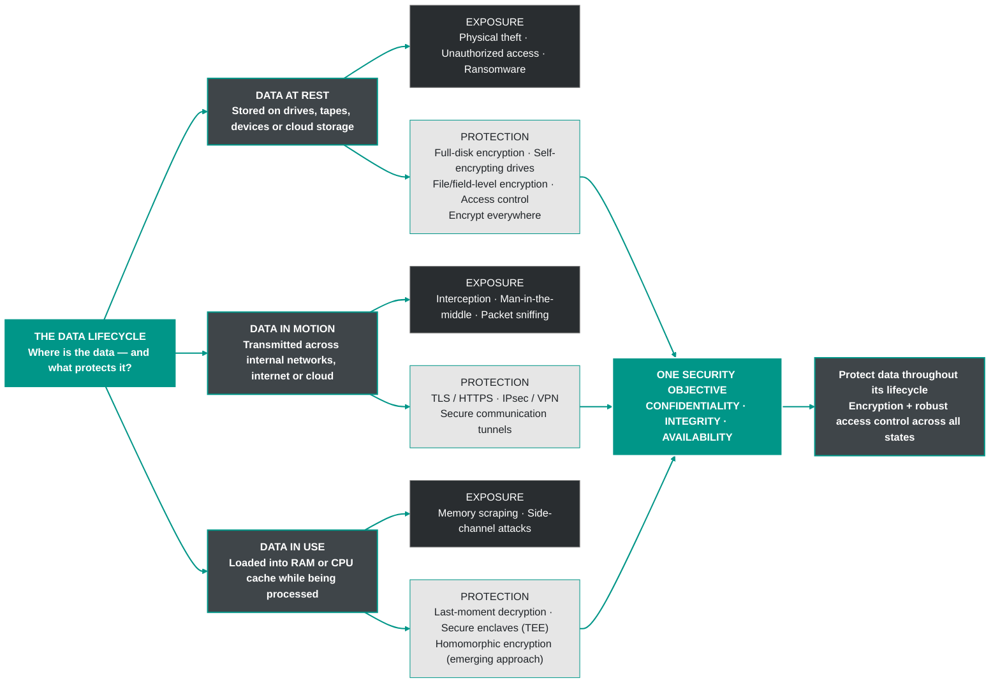
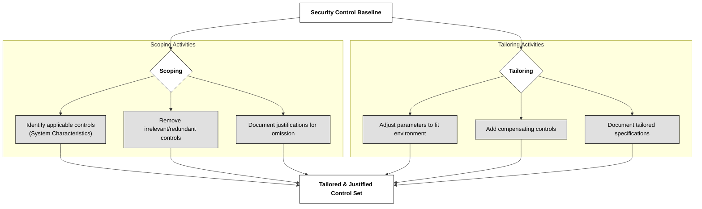
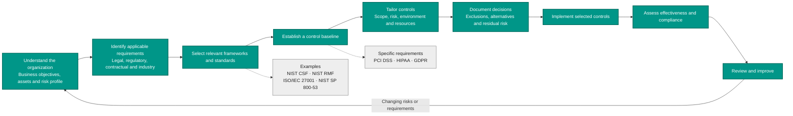

# 2.6 Determine data security controls and compliance requirements
## 2.6.1 Data States ##

Data can exist in three states: data at rest, data in motion, and data in use. Each state presents unique security challenges and requires different protection mechanisms.

> ✓ For each data state, you must ensure its Confidentiality, Integrity, and Availability.

**Data at rest** refers to data that is `stored on a device or in a storage medium`, such as hard drives, solid-state drives, backup tapes, or cloud storage. This data is not actively being used or transmitted, making it a prime target for attackers who gain physical access to the storage device or compromise the system remotely. **Encryption is the most effective way to protect data at rest**. By encrypting data, even if an attacker gains access to the storage device, they cannot read the data without the encryption key.. Modern operating systems and third-party software offer encryption solutions for individual files, entire volumes, or even whole-disk encryption. 

Organizations should have policies requiring encryption of sensitive data, such as personally identifiable information (PII) and protected health information (PHI). Encrypting all data stored anywhere, an **encrypt everywhere** approach, mitigates the risk of accidental storage of sensitive information in unencrypted volumes.

Examples of data at rest protection measures include:
1. Full disk encryption: Encrypting an entire hard drive volume.
2. Self-encrypting drives (SEDs): Hard drives or solid-state drives that automatically encrypt and decrypt data without additional software.
3. File-level encryption: Encrypting individual files.
4. Field-level encryption: Encrypting specific data fields within a file.
5. Access control: Restricting physical and logical access to storage devices and systems.

**Data in motion**, also known as **data in transit** or data in flight, refers to data that is `being transmitted over a network`. This includes data transmitted over internal networks, the internet, and to the cloud. 
Data in motion is particularly vulnerable as it travels outside the protected confines of networks and can be intercepted by attackers. Strong encryption, such as Transport Layer Security (TLS) and IPSec, is crucial for protecting data in motion. TLS uses digital certificates to authenticate the server, while IPSec provides secure connections between networks or devices. Data in motion is usually encrypted by:
1. Transport Layer Security (TLS): A cryptographic protocol that secures communications over the internet, commonly used for HTTPS websites.
2. IPSec: A suite of protocols that provide secure communication between devices or networks, often used for VPNs.
3. Virtual Private Networks (VPNs): Create secure connections between remote users and corporate resources or between geographically dispersed networks, providing secure communication over untrusted networks like the internet.

**Data in use** refers to data that is `actively being processed by an application or system and is temporarily stored in volatile memory, such as RAM, CPU caches, or registers`. Protecting data in use is challenging because it needs to be decrypted before processing, making it vulnerable to attacks that target the system's memory. While encryption cannot directly protect data in use, strategies like decrypting data at the last moment before processing and encrypting it as soon as it leaves the CPU registers can enhance security. However, this approach is computationally expensive and requires specialized hardware, such as cryptographic co-processors.
Emerging technologies, such as homomorphic encryption, offer promising solutions for protecting data in use. Homomorphic encryption allows computations on encrypted data without decryption, meaning the data remains encrypted throughout the processing. Although not yet practical for widespread use, advancements in homomorphic encryption could revolutionize data security in the future. Homomorphic encryption enables computations on encrypted data without decryption, preserving data confidentiality throughout processing.

**Side-channel attacks** pose a significant threat to data in use. These attacks exploit information leaked by a cryptosystem, such as power consumption or processing time, to deduce sensitive information, including encryption keys. For example, the Heartbleed vulnerability demonstrated how attackers could exploit memory vulnerabilities to access sensitive data from other processes running on the same system. Similarly, attacks like Meltdown, Spectre, and BranchScope leverage hardware features in modern CPUs to exploit memory access patterns and steal data in use.

> ℹ Audio data can be kept private by using headphones to prevent eavesdropping, while protecting written data often requires physical measures like protective screens or privacy filters.

The following table recaps what we have seen so far:

| Data State       | Definition                                                                                             | Risks                                                                 | Protection Measures                                                                                             |
|------------------|--------------------------------------------------------------------------------------------------------|------------------------------------------------------------------------|------------------------------------------------------------------------------------------------------------------|
| **At rest**      | Data stored on devices or storage media (e.g., drives, tapes, cloud) not currently moving or being used  | Physical theft, unauthorized system access, ransomware                | Full-disk encryption, self-encrypting drives, file/field-level encryption, access control, "encrypt everywhere" |
| **In motion**    | Data being transmitted over networks (internal, internet, or cloud)  | Interception, man-in-the-middle, packet sniffing                     | TLS/HTTPS, IPSec/VPN, secure communication tunnels                                                               |
| **In use**       | Data loaded into memory (RAM, CPU cache) while being processed  | Memory scraping, side-channel attacks                                | Last-moment decryption, secure enclaves (TEE), emerging approaches like homomorphic encryption                 |
| **Common goal** | Ensure **Confidentiality**, **Integrity**, and **Availability** (CIA triad) for every data state       | —                                                                      | Encryption and robust access control across all states                                                           |

### Open Questions ###

1. Explain the difference between data at rest and data in transit.

  
Show answer

Data at rest refers to data stored on a device or system and not actively being used. Data in transit is data that is actively being transmitted over a network.

2. List three methods of data encryption and briefly describe their scope of protection.

  
Show answer

Full-disk encryption: Encrypts an entire storage drive. 

File-level encryption: Encrypts individual files. 

Field-level encryption: Encrypts specific data fields within a file.

3. What is the primary purpose of using encryption as a security control?

  
Show answer

Encryption is primarily used to protect the confidentiality of data by making it unreadable without the proper decryption key. This prevents unauthorized access and disclosure of sensitive information.

4. Describe two technologies that can be used to secure data in transit.

  
Show answer

TLS (HTTPS) and VPNs are two common technologies used to secure data in transit. TLS encrypts data exchanged between web browsers and servers, while VPNs create secure, encrypted tunnels over public networks.

5. What is the main challenge associated with securing data in use?

  
Show answer

The main challenge with securing data in use is that data is typically decrypted in memory for processing, making it vulnerable to attacks.

6. What is a TPM and how can it be used for data security?

  
Show answer

A TPM is a hardware chip that provides secure storage of cryptographic keys and can be used for full-disk encryption. It helps authenticate the platform during boot-up, ensuring that the system hasn't been tampered with.

7. Differentiate between link encryption and end-to-end encryption.

  
Show answer

Link encryption encrypts data at each hop in a network path, while end-to-end encryption ensures that only the sender and the intended recipient can decrypt the data.

8. Briefly describe how a man-in-the-middle attack works.

  
Show answer

In a man-in-the-middle attack, the attacker intercepts communication between two parties and potentially impersonates one or both to gain access to sensitive information.

9. What is a side-channel attack, and why is it a concern for data security?

  
Show answer

A side-channel attack exploits information leakage from a system's physical implementation, like power consumption or timing differences. It can be used to infer sensitive data or compromise cryptographic keys.

10. What is homomorphic encryption, and what potential advantage does it offer?

  
Show answer

Homomorphic encryption allows computations to be performed on encrypted data without decryption. This has the potential to enable secure processing of sensitive data without compromising confidentiality.

---

## 2.6.2 Scoping and Tailoring ##

As a security expert, you play a crucial role in ensuring that security controls are not just implemented, but implemented effectively. This involves adapting general security recommendations from frameworks and guidelines to your organization's specific context. Two key processes in this adaptation are scoping and tailoring.

**Scoping** involves `determining which security controls are applicable to the systems and assets you need to protect`. It's about eliminating controls that are redundant or unnecessary for your environment. For instance, if your system doesn't allow concurrent logins, there's no need for a control addressing concurrent session management. Scoping demands careful consideration and documented justification for omitting any controls from the baseline.

**Tailoring**, on the other hand, focuses on `modifying the implementation of controls to align with the organization's specific requirements`. This might involve adjusting the control's parameters or substituting it with a compensating control that achieves a similar security outcome. Imagine an organization with a central office and a remote site. The baseline control set might work perfectly for the central office but prove impractical for the remote location. Tailoring allows for adjustments, such as implementing compensating controls, to address the unique circumstances of the remote site.

🔗 Scoping and tailoring were first introduced in [1.3 Evaluate, apply, and sustain security governance principles](../DOMAIN1%20-%20Security%20Governance%20and%20Risk%20Management/1.3%20Evaluate,%20apply,%20and%20sustain%20security%20governance%20principles.md)

Scoping and tailoring work hand in hand, first identifying relevant controls and then fine-tuning their implementation.

Key Considerations for Scoping and Tailoring:
1. **Organizational Mission and Objectives:** Security controls should support the organization's core functions and strategic goals.
2. **Risk Assessment:** The selection and modification of controls should be driven by a thorough understanding of the organization's risk profile, including threats, vulnerabilities, and impact assessments.
3. **Resource Constraints:** Consider the organization's budget, staffing, and technical capabilities when making decisions about scoping and tailoring.
4. **Operational Impact:** Evaluate how the chosen controls will affect the organization's day-to-day operations and ensure they do not create undue burdens.
5. **Documentation:** Meticulously document all scoping and tailoring decisions, including the rationale behind them. This documentation is essential for demonstrating compliance, facilitating audits, and ensuring continuity.

> ⚠  Convenience should never be the driving force behind removing or altering security controls. Any changes must be justified based on operational needs and their potential impact on risk. 

### Open Questions ###

1. What is the primary purpose of tailoring security controls?

  
Show answer

Tailoring security controls aims to customize a set of baseline security controls to align with an organization's specific security requirements, risk tolerance, and operational context. It ensures that the controls are effectively implemented and relevant to the organization's needs.

2. Explain the relationship between tailoring and an organization's mission.

  
Show answer

Tailoring ensures the chosen security controls align directly with the organization's mission. By considering the organization's goals and objectives, tailoring helps select controls that protect the most critical assets and processes, ensuring the organization can achieve its mission securely.

3. What is the key difference between scoping and tailoring in security control implementation?

  
Show answer

Scoping involves selecting the relevant security controls from a broader standard or baseline and eliminating those that are not applicable. Tailoring, on the other hand, involves modifying the selected controls to better address the organization's specific requirements and constraints.

4. Provide an example of a situation where compensating controls might be necessary in the tailoring process.

  
Show answer

Compensating controls might be necessary when a baseline control cannot be implemented in a specific environment. For example, if a remote office lacks the infrastructure for a specific control, a compensating control with equivalent security measures can be implemented.

5. Why is it important to document the decisions made during the scoping and tailoring process?

  
Show answer

Documenting scoping and tailoring decisions provides transparency and accountability for the security choices made. This documentation helps auditors understand the rationale behind the implemented controls and demonstrates compliance efforts.

6. If a baseline recommends a control that is already implemented more comprehensively, how should this be addressed during tailoring?

  
Show answer

If a control is already implemented more comprehensively than the baseline recommendation, this should be documented during tailoring. The organization can justify retaining the existing implementation, demonstrating that it meets or exceeds the baseline requirements.

7. What is the significance of "control value" in the context of tailoring?

  
Show answer

"Control value" refers to the specific parameter or setting of a security control. Tailoring may involve adjusting these values to align with the organization's risk tolerance and operational needs. For example, the number of allowed login attempts before an account lockout can be modified.

8. Why is it essential to rigorously defend decisions to omit controls from a baseline?

  
Show answer

Rigorously defending decisions to omit controls from a baseline is crucial to ensure that security risks are not overlooked. Organizations must provide clear and documented justification, demonstrating that alternative controls or risk mitigation strategies are in place.

9. In what scenario might a company need to scope a security standard received from a parent company?

  
Show answer

A company might need to scope a parent company's security standard if the subsidiary company has different policies or practices. For example, if the parent company allows BYOD (Bring Your Own Device) but the subsidiary company prohibits it, the BYOD sections would be removed during the scoping process.

---

## 2.6.3 Standards and Controls Selection ##

A security framework gives an organization a structured way to manage information security. It helps establish governance, define responsibilities, assess risks, and organize security activities. However, adopting a framework does not automatically make an organization secure or compliant.
Think of a framework as a roadmap, a standard as a set of defined requirements or practices, and a control as a specific safeguard implemented to reduce risk.

There is no single framework or standard that fits every organization. Selection should reflect the organization's business objectives, risk profile, information sensitivity, technology environment, industry, jurisdiction, contractual obligations, and available resources.

> ℹ Organizations can adopt an established framework, combine elements from multiple sources, and tailor the resulting control baseline. The objective is not to implement every control available; it is to select controls that address relevant risks and applicable requirements.

**NIST SP 800-37** describes the Risk Management Framework for managing security and privacy risks throughout the system lifecycle. It provides a structured process for categorizing systems, selecting and implementing controls, assessing their effectiveness, authorizing systems, and continuously monitoring them.

The **NIST CSF** helps organizations understand, assess, prioritize, and communicate cybersecurity risk. It is voluntary and can be used by organizations of different sizes and sectors.

The CSF 2.0 is organized around six functions:

- **Govern**: Establish and monitor cybersecurity risk-management strategy, expectations, and responsibilities.
- **Identify**: Understand the organization's assets, risks, and cybersecurity environment.
- **Protect**: Implement safeguards to reduce cybersecurity risk.
- **Detect**: Identify potential cybersecurity incidents.
- **Respond**: Take action when a cybersecurity incident occurs.
- **Recover**: Restore affected capabilities and services.

**ISO/IEC 27001** specifies requirements for establishing, implementing, maintaining, and continually improving an **Information Security Management System (ISMS)**. It requires an organization to assess and treat information security risks in a way that fits its context.
ISO/IEC 27002 complements it by providing guidance on information security controls and their implementation. In simple terms, ISO 27001 defines the requirements for the management system, while ISO 27002 helps organizations understand and apply security controls.

**NIST SP 800-53** provides a comprehensive catalog of security and privacy controls. Organizations use it to select, tailor, and implement controls according to their requirements and risk assessments.

**NIST SP 800-53A** provides assessment procedures for evaluating whether those controls are implemented correctly, operating as intended, and producing the desired results.

**FIPS 199** and **FIPS 200** are Federal Information Processing Standards support the protection of U.S. federal information systems.

- FIPS 199 provides a method for categorizing information and information systems according to the potential impact of a loss of confidentiality, integrity, or availability.
- FIPS 200 defines minimum security requirements for federal information systems and organizations.

Some requirements apply because of an organization's industry, activities, location, or contractual relationships.

Examples include:
- **PCI DSS**: Security requirements for entities that store, process, or transmit payment card account data.
- **HIPAA**: U.S. requirements for protecting certain health information handled by covered entities and business associates.
- **GDPR**: EU data protection regulation that applies to organizations and processing activities within its scope, including certain organizations outside the EU.

> ⚠ These requirements are not interchangeable with voluntary frameworks. An organization must identify which laws, regulations, contractual obligations, and industry requirements actually apply to its operations. For example, an organization processing payment card data may use ISO 27001 as its overall security management framework while also implementing the specific requirements of PCI DSS. Adopting ISO 27001 does not automatically demonstrate PCI DSS compliance.

A framework or standard provides a starting point, not a universal checklist. Organizations must adapt their security controls to their own circumstances.

This involves:

1. Identifying applicable legal, regulatory, contractual, and business requirements.
2. Understanding the information assets and their classification.
3. Assessing threats, vulnerabilities, risks, and business impact.
4. Selecting appropriate controls from relevant frameworks and standards.
5. Tailoring controls to the organization's environment and risk appetite.
6. Documenting justified exclusions, alternative controls, and residual risks.
7. Periodically reviewing the baseline as risks, technologies, and requirements change.

For example, a small organization handling public information may not need the same level of protection as a financial institution processing sensitive customer records. Both need appropriate security, but their control baselines should reflect their different risks and obligations.

> ✓ Select standards and controls based on business context, risk, and applicable requirements. A framework provides structure, a standard provides defined requirements or guidance, and controls provide the safeguards that protect the organization's assets.

### Open Questions ###

1. What is the difference between a security framework, a security standard, and a security control?

 
Show answer

A framework provides an overall structure for managing security, a standard defines requirements or recommended practices, and a control is a specific safeguard used to address a security risk. For example, ISO/IEC 27001 provides ISMS requirements, ISO/IEC 27002 provides control guidance, and MFA is a specific security control.

2. Why might an organization voluntarily adopt a recognized security framework even when it is not legally required to do so?

 
Show answer

A recognized framework provides a structured approach to identifying and managing security risks, improving consistency, and communicating security expectations to stakeholders. It can also help demonstrate the organization's commitment to sound security practices.

3. What factors should an organization consider when selecting a security framework or standard?

 
Show answer

The organization should consider its business objectives, risk profile, information sensitivity, industry, applicable laws and regulations, contractual obligations, technology environment, and available resources. The selected approach must be appropriate for its actual needs.

4. What is the primary purpose of the NIST Cybersecurity Framework (CSF)?

 
Show answer

The NIST CSF provides a flexible structure for understanding, assessing, prioritizing, and communicating cybersecurity risk. It can be used by organizations of different sizes and across different sectors.

5. What are the six core functions of NIST CSF 2.0, and what does each address?

 
Show answer

- Govern: Establish cybersecurity risk-management strategy and responsibilities.
    
- Identify: Understand assets, risks, and the organizational environment.
    
- Protect: Implement safeguards.
    
- Detect: Identify potential cybersecurity incidents.
    
- Respond: Take action to manage incidents.
    
- Recover: Restore affected services and capabilities.
    

6. What is the difference between NIST SP 800-53 and NIST SP 800-53A?

 
Show answer

NIST SP 800-53 provides a catalog of security and privacy controls that organizations can select and tailor. NIST SP 800-53A provides assessment procedures to evaluate whether those controls are properly implemented and operating as intended.

7. What is the purpose of ISO/IEC 27001, and what is an ISMS?

 
Show answer

ISO/IEC 27001 specifies requirements for establishing, implementing, maintaining, and continually improving an Information Security Management System. An ISMS is a systematic approach to managing information security risks through policies, processes, responsibilities, and controls.

8. How does ISO/IEC 27002 complement ISO/IEC 27001?

 
Show answer

ISO/IEC 27001 specifies the requirements for an ISMS, while ISO/IEC 27002 provides guidance on information security controls and their implementation. Together, they help organizations establish and operate a structured information security management approach.

9. An organization processes payment card data and already follows ISO/IEC 27001. Does this automatically mean it complies with PCI DSS? 

 
Show answer

No. ISO/IEC 27001 provides an information security management framework, but PCI DSS has its own specific requirements for protecting payment card account data. The organization must independently assess and meet the PCI DSS requirements applicable to its environment.

10. Why should an organization tailor its security control baseline instead of implementing every available control at the highest possible level?**

 
Show answer

Controls should be selected according to the organization's risks, asset value, business requirements, regulatory obligations, and resources. Applying every control at the highest level may be unnecessarily expensive, while insufficient controls can leave unacceptable risks unaddressed.

---
## 2.6.4 Data protection methods (e.g., Digital Rights Management (DRM), Data Loss Prevention (DLP), Cloud Access Security Broker (CASB)),Cloud-Native Application Protection Platform (CNAPP))

Data security controls are essential for protecting the confidentiality, integrity, and availability of data. These controls should be implemented throughout the data lifecycle, from creation to disposal.
Digital assets, defined as anything existing in digital form with intrinsic value requiring restricted access, need various controls to ensure data preservation and prevent compromise. Storage media, encompassing electronic and non-electronic forms, requires specific considerations for protection. Unauthorized access prevention is paramount, achievable through physical, administrative, and technical controls. 

Digital asset libraries, often managed by a librarian, can help organizations protect their digital assets. Libraries often implement check-out procedures, especially for licensed software, to track asset usage and demonstrate due diligence in compliance with licensing agreements and confidential information protection.
Storage media management is critical, requiring clear marking, logging, integrity verification, and secure data erasure when no longer needed. Failure to properly erase data from obsolete equipment before disposal can lead to data disclosure risks, legal and ethical violations. Overwriting techniques, including secure overwriting algorithms, are necessary for data erasure.

Secure disposal methods are also required for non-digital forms of information, like paper, microfilm, and microfiche. Dumpster diving, the act of searching through trash for valuable information, highlights the importance of shredding or burning sensitive information before disposal. 

Organizations can leverage several technologies and methodologies to strengthen their data protection strategies:
1. **Encryption**: Encryption transforms data into an unreadable format, making it incomprehensible to unauthorized individuals. This is a fundamental method for protecting data confidentiality.  See also: [3.6 Select and determine cryptographic solutions](../DOMAIN3%20-%20Security%20Architecture%20and%20Engineering/3.6%20Select%20and%20determine%20cryptographic%20solutions.md)
2. **Data Loss Prevention (DLP)**: DLP technologies and practices prevent sensitive data loss or unauthorized access. These solutions identify, classify, and protect data throughout its lifecycle, covering data at rest, in transit, and in use. DLP implementations typically involve discovery and classification, monitoring, and enforcement stages.
3. **Digital Rights Management (DRM)**: DRM focuses on controlling the use, modification, and distribution of intellectual property. It employs techniques like licensing, persistent online authentication, continuous audit trails, and automatic expiration to protect copyrighted works from unauthorized use. DRM methods, like steganography and metadata embedding, can help detect and enforce copyright protection. 
4. **Information Rights Management (IRM)**: IRM is a related technology to DRM that protects sensitive data from unauthorized access by controlling who can view, copy, delete, or modify the data. 
5. **Cloud Access Security Broker (CASB)**: CASBs act as intermediaries between cloud users and cloud services, monitoring and enforcing security policies for cloud-based data. They provide visibility into cloud usage, enhance data security, protect against threats, and aid in compliance with regulatory requirements. There are three primary types of CASB solutions: forward proxy, reverse proxy, and API-based, each with their advantages and deployment considerations.

> ℹ  A Data Loss Prevention (DLP) system works by monitoring, detecting, and blocking the unauthorized transmission of sensitive data across networks or endpoints. It uses content inspection techniques such as pattern matching, keyword recognition, and contextual analysis to identify sensitive information like credit card numbers, personal identifiers, or intellectual property. DLP systems enforce policies by applying rules that determine what data can be accessed, shared, or transferred, based on its classification or type. These systems typically operate at various levels, such as endpoint DLP (on individual devices) or network DLP (monitoring network traffic), and may include features like encryption or alerts to prevent data leaks.

> ℹ  **Cloud Access Security Broker (CASB)** solutions are critical for managing and securing access to cloud services and enforcing security policies across cloud environments. There are three primary types of CASB solutions: forward proxy, reverse proxy, and API-based solutions. Each type operates differently, with distinct advantages and deployment considerations.
> 1. Forward Proxy CASB: A forward proxy CASB sits between the user and the cloud application. It intercepts user requests to cloud services and applies security policies such as authentication, encryption, or malware scanning before allowing access. The solution is typically deployed on the network perimeter, monitoring outbound traffic. It works well for enforcing security policies across known cloud applications, but it can be challenging to deploy when users are on unmanaged devices or mobile networks. It is most effective when controlling access to a specific set of cloud apps and in environments with high traffic to cloud services. However, it may not cover unsanctioned apps or traffic encrypted via SSL/TLS without deep packet inspection.
> 2. Reverse Proxy CASB: A reverse proxy CASB is deployed in front of cloud applications, controlling access to those applications. Unlike a forward proxy, which sits between the user and the cloud service, a reverse proxy intercepts requests from the cloud services to ensure they are legitimate and meet security requirements before being granted access. This method allows security policies to be enforced for cloud applications without requiring configuration changes on users' devices. A reverse proxy CASB works best for controlling access to cloud applications for users in the organization but may have limitations when it comes to monitoring the traffic of external users or applications that bypass this method. It is often easier to implement for companies with a smaller number of cloud services but can struggle with large, complex environments with many apps.
> 3. API-based CASB: API-based CASB solutions leverage application programming interfaces (APIs) to interact directly with cloud services. This type of CASB allows organizations to enforce security policies by directly accessing the cloud service’s management layer via APIs, providing deep visibility and control over data and user activity. With an API-based approach, the CASB can monitor data stored in the cloud, enforce encryption, detect threats, and apply access controls. It is particularly effective in cloud-native environments, as it can provide more granular visibility of data activities and prevent data loss in cloud apps. However, it may require more integration work to connect with various cloud platforms, and it may not provide the same level of protection for real-time user traffic as forward or reverse proxies.

AI systems are remarkably good at finding patterns, which makes them a nightmare for privacy if not properly managed. There are primarely two technical controls to protect PII within AI:

1. **Data Masking and Anonymization:** Traditional masking replaces sensitive fields with "X's." However, AI can sometimes "re-identify" masked individuals by correlating other data points.
2. **Differential Privacy:** This is the gold standard for AI privacy. By mathematically adding "noise" to the dataset, we ensure that the model learns general trends without being able to identify or "memorize" any specific individual's data.

The following table contrasts **Encryption**, **Tokenization**, **Data Masking**, **Pseudonymization**, **Anonymization**, and **Differential Privacy**:

| Technique                | Core Mechanism                                                                                                                                                        | Reversibility & Key Dependency                                                                                                        | GDPR & Privacy Status                                                                                                                                      | Primary Use Case & Threat / Attack Focus                                                                                                                     |
| :----------------------- | :-------------------------------------------------------------------------------------------------------------------------------------------------------------------- | :------------------------------------------------------------------------------------------------------------------------------------ | :--------------------------------------------------------------------------------------------------------------------------------------------------------- | :----------------------------------------------------------------------------------------------------------------------------------------------------------- |
| **Encryption**           | Transforms plaintext into ciphertext via a cryptographic algorithm and key                                                                                            | **Reversible** with the authorized decryption key (cryptographic strength depends on key management)                                  | Remains **personal data** when linked to an identifiable person; acts as a security control under GDPR Art. 32                                             | Protects confidentiality of data at rest and in transit (e.g., TLS, disk/column encryption) against unauthorized access or interception                      |
| **Tokenization**         | Replaces sensitive data elements (e.g., PANs) with non-sensitive surrogate **tokens** mapped in a secure token vault (or via format-preserving/cryptographic schemes) | **Reversible** via an external **token vault** or authorized token service (detokenization)                                           | Remains **personal data** if the mapping/vault is accessible or re-identifiable; reduces scope of systems handling raw sensitive values                    | Minimizes sensitive data exposure across payment, CRM, and cloud workflows                                                                                   |
| **Data Masking**         | Obscures or alters values (e.g., character masking `****1234`, shuffling, substitution, redaction) while preserving format or schema usability                        | **Static masking is irreversible** on the masked copy; **dynamic masking** reveals real values only to authorized roles at query time | Often treated as **pseudonymization** (still personal data) if re-identification is possible, or **anonymized** only if truly irreversible                 | Enables safe non-production testing, QA, support, and analytics without exposing live production PII/PCI                                                     |
| **Pseudonymization**     | Replaces direct identifiers with a pseudonym while keeping linking/lookup data separate under technical and organizational controls (GDPR Art. 4(5))                  | **Reversible** by the party holding the separate mapping/key/additional information                                                   | **Still personal data** under GDPR (encouraged to reduce risk, but full GDPR obligations still apply)                                                      | Enables analytics, cross-system correlation, or data sharing with strict access separation while lowering direct exposure risk                               |
| **Anonymization**        | Irreversibly strips or transforms data (via generalization, aggregation, noise, suppression) so individuals cannot be identified directly or indirectly               | **Irreversible** (one-way transformation; re-identification must not be reasonably achievable)                                        | **Outside GDPR** scope once genuinely and irreversibly anonymized (subject to re-identification / "motivated intruder" risk)                               | Safe publication of open datasets, broad statistical reporting, and secondary analytics where individual attribution is not needed                           |
| **Differential Privacy** | Adds calibrated statistical noise (governed by privacy budget $\varepsilon$ and $\delta$) to queries or gradient updates during model training                        | **Statistically non-invertible** at the individual record level (bounds single-record influence mathematically)                       | Supports privacy-preserving data release and ML training; reduces leakage risk, though GDPR compliance still depends on context and re-identification risk | Protects **AI/ML models** and statistical outputs against **membership inference attacks** and training-data memorization while preserving aggregate utility |
### Open Questions ###

1. Describe the three core stages of a Data Loss Prevention (DLP) implementation.

  
Show answer

DLP implementation involves: (1) Discovery and Classification: identifying and categorizing sensitive data; (2) Monitoring: inspecting data movement and usage to detect policy violations; (3) Enforcement: taking actions such as blocking or alerting based on policy violations and data sensitivity.

2. Differentiate between DLP at rest, in transit, and in use.

  
Show answer

DLP at rest: secures data stored on devices through encryption and access control. DLP in transit: monitors network traffic to prevent unauthorized data transfer. DLP in use: protects data being actively used on endpoints, controlling actions like copy/paste and screen capture.

3. What is a Cloud Access Security Broker (CASB) and what are its four primary functions?

  
Show answer

A CASB acts as an intermediary between cloud users and services, enforcing security policies and protecting data in the cloud. Its four functions are: Visibility: providing insight into cloud usage; Data security: preventing data exfiltration; Threat protection: guarding against insider threats; Compliance: ensuring adherence to regulatory requirements.

4. Compare the three primary deployment models of a Cloud Access Security Broker (CASB).

  
Show answer

Forward proxy CASB: resides on user devices, inspecting traffic through encryption. Reverse proxy CASB: integrates with identity services, routing traffic through the CASB. API-based CASB: directly interacts with cloud service APIs to monitor data within the cloud. Each offers varying levels of control, deployment complexity, and compatibility.

5. Explain the concept of Digital Rights Management (DRM) and provide some methods associated with DRM solutions.

  
Show answer

DRM aims to protect the copyright of digital works by controlling access, usage, and distribution. Methods include DRM licenses, persistent online authentication, continuous audit trails, automatic expiration, and digital watermarks to deter unauthorized use and piracy.

6. What are the arguments for and against the use of DRM?

  
Show answer

Arguments for DRM: Prevents revenue loss from piracy, protects intellectual property, and allows for greater control over content distribution. Arguments against DRM: Restricts fair use by legitimate consumers, may be circumvented, and can create inconvenience for authorized users.

---
<small>🎓 This learning resource is part of CISSP Zero-to-Hero by TheInfoSecVault. For more explanations, practice questions and performance monitoring, visit [www.theinfosecvault.com](https://www.theinfosecvault.com). If you reuse this content, please credit TheInfoSecVault and link to the original source.</small>